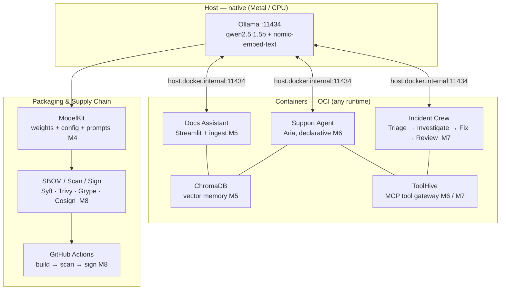

import Slides from '@site/src/components/Slides';

# Capstone: Ship the Acme AI Support Platform

> You have run eight modules, and each one has been a self-contained building block. This capstone snaps them all together into one deployable product, the **Acme AI Support Platform**, and proves it ships without any changes on any OCI runtime.

---

## Module slides

Walk this short whiteboard deck for the big picture before the hands-on lab, or open it fullscreen.

<Slides src="decks/09-capstone.html" title="Capstone — Ship the Platform" />

## 1. The Platform at a Glance

**Analogy:** Imagine the platform as a well-run emergency dispatch centre. The dispatcher, that is the native Ollama model, is the shared brain. One expert sits at the desk and takes calls from every team at the same time. Each team (the Docs Assistant, the Support Agent, the Incident Crew) has its own job description and its own phone line, but they all ring the same dispatcher. The dispatcher never moves. The filing cabinets behind the desk are ChromaDB, semantic memory organised by meaning rather than alphabetical order. ToolHive is the secure key cabinet. Every agent that needs an external tool must sign out a key, and no rogue process reaches in unsupervised. When a release is ready, the package gets sealed in a ModelKit (the tamper-evident courier box), checked by the supply chain tools, and shipped out by CI.

The container boundary is the single rule this whole course is built on: **the model stays native, everything else runs in a container.**



Here is the single address that makes the whole wiring work: every container reaches the native model at `http://host.docker.internal:11434`. That address resolves on Colima, Rancher Desktop, OrbStack, and Podman, with no changes needed. It is part of the OCI runtime contract, not a Docker-specific trick.

---

## 2. Run It End-to-End

### Step 0 — Verify readiness

Before touching any module, run the platform readiness check from `labs/capstone/`:

```bash
./platform-check.sh
```

Expected output:

```
== 1. Container runtime ==
  ✔ docker CLI + engine reachable
== 2. Model serving (native Ollama, OpenAI-compatible) ==
  ✔ Ollama serving on :11434
  ✔ chat model present (qwen2.5)
  ✔ embedding model present (nomic-embed-text)
== 3. Container → native model wiring ==
  ✔ containers reach the model via host.docker.internal
== 4. Packaging + supply chain tooling ==
  ✔ kit (KitOps) installed
  ✔ thv (ToolHive) installed
  ✔ syft / trivy / grype / cosign installed

PLATFORM READY — serve → RAG → agent → crew → package → secure → ship.
```

Every green tick maps back to something you built and validated in an earlier module. A red `✗` tells you exactly which layer is missing, and which module covers it.

:::tip[Try the Container X-Ray]

`platform-check.sh` gives you a point-in-time pass or fail. For a live view as you bring the platform up, run `bash labs/tools/container-xray/serve.sh` and open the printed URL. Its Platform lens shows every course image cached on this machine (M2 through M8), the total image disk usage, and an everything-running overview. The Stack lens shows the capstone compose project's services, volumes, and networks as you start them. See `labs/tools/container-xray/README.md`.

:::

### Step 1 — Serve the model (M2 / M3)

The model server is already running, Ollama serves natively on the host:

```bash
ollama serve          # already running if you followed M2
curl http://localhost:11434/v1/models
```

For the CPU-vLLM path (SmolLM2 on a machine without Apple Silicon Metal), see the [M3 lab](../m3-vllm/lab). All downstream containers use the model through the standard OpenAI-compatible `/v1` API. That is the wall-socket idea from [M2](../m2-serving/lesson): any container can swap the model behind it without touching a line of code.

### Step 2 — Start the platform (M5 + shared ChromaDB)

All persistent services, that is ChromaDB and the Docs Assistant, start from the single consolidated compose file in `labs/capstone/`. This avoids the per-module port conflict: each module's `compose.yaml` binds its own `chromadb` to port 8000, so running them one after another hits "container name already in use". The capstone compose starts ONE shared ChromaDB that all three apps use.

```bash
cd labs/capstone
docker compose up -d chromadb genai-app
```

Expected output:

```
 Network capstone_default Created
 Volume capstone_chroma_data Created
 Container chromadb Started
 Container genai-app Started
```

On first run, the ingest script embeds the Acme runbooks and writes them to the vector store. Visit `http://localhost:8501`, ask "How do I restart the payments service?", and you get a grounded answer with the exact `kubectl` command pulled straight from the runbook, not a hallucinated guess.

See the [M5 lab](../m5-naive-rag/lab) for the step-by-step compose walkthrough.

### Step 3 — Run the Support Agent (M6)

With ChromaDB already running, run the M6 agent as a one-shot against the same shared vector store. Stay in `labs/capstone/`:

```bash
docker compose run --rm agent "How do I restart the payments service?"
```

Expected output (abbreviated):

```
[agent] Aria ready — ingested 5 runbook chunks. Persona from SOUL.md + AGENTS.md + SKILL.md.
USER: How do I restart the payments service?
  [decision: RETRIEVE (top dist=216.8)]
ARIA: Run `kubectl rollout restart deploy/payments -n prod`. The payments service depends on the
      Postgres primary in the `prod` namespace.
```

Aria, the declarative agent from M6, reads the question, decides whether it needs to retrieve from ChromaDB at all, and returns a grounded, guardrailed answer. This is agentic RAG: the agent routes first, then acts.

:::note[Phrasing matters for a small model's routing]

`qwen2.5:1.5b`'s routing step is a single yes or no judgment call. Vaguer phrasing (for example, "payments
pod keeps restarting, what do I do?") can miss and answer directly instead of retrieving, and the model
then hallucinates a plausible-looking command instead of giving you the real runbook answer. Ask the same
way M6's own lab does: a direct "how do I restart X" question that mirrors the runbook's own language, and
the routing decision stays reliable. If you ever see `ANSWER DIRECTLY` where you expected `RETRIEVE`, check
the `[decision: ...]` marker in the output before you trust the answer. That marker is exactly how you
catch an ungrounded response.

:::

See the [M6 lab](../m6-declarative-agent/lab).

### Step 4 — Fire the Incident Crew (M7)

Still in `labs/capstone/`, run the incident crew one-shot:

```bash
docker compose run --rm crew "P1: payments service down, pods in CrashLoopBackOff"
```

Expected output (abbreviated):

```
[crew] Acme Incident Crew: Triage -> Investigator -> Fixer -> Reviewer

[TRIAGE]      AREA: payments | SEV: 3 | ...   # numeric severity; exact scale/wording varies by run
[INVESTIGATOR] kubectl rollout restart deploy/payments -n prod ...
[FIXER]       kubectl rollout restart deploy/payments -n prod
[REVIEWER]    APPROVED — ready for a human to apply
```

Four specialised agents run one after another: Triage classifies the incident, Investigator queries the runbook, Fixer proposes the exact fix command, and Reviewer approves it or escalates it. One native model endpoint serves all four agents.

See the [M7 lab](../m7-multi-agent/lab) for the full compose wiring and the approval-gate logic.

:::tip[Teardown]

When you are done with Steps 2 through 4, tear down all platform containers from `labs/capstone/`:

```bash
docker compose down
```

:::

### Step 5 — Package the model (M4)

This step packages the model weights you downloaded in the [M4 lab](../m4-packaging/lab)'s Step 2.
If you skipped M4, run that download first.

```bash
export GITHUB_USER=your-github-username
cd labs/m4
kit pack . -t ghcr.io/${GITHUB_USER}/support-model:v1.0
kit push  ghcr.io/${GITHUB_USER}/support-model:v1.0
```

The model weights, system prompt, and quantization config get sealed into a single OCI artifact, a ModelKit. Any CI job or serving node pulls exactly that version with one command. No shared drives. No Slack links. No "also grab the prompt file from the other folder." See the [M4 lab](../m4-packaging/lab).

### Step 6 — Secure the crew image (M8)

Build the crew image locally first (or reuse the one from M7), then run the supply chain script against the **local** image tag. Syft, Trivy, and Grype scan the local image without pulling from a registry:

```bash
# Ensure the crew image is built locally
docker build -t acme-incident-crew:latest labs/m7/

cd labs/m8
./secure-image.sh acme-incident-crew:latest
```

Expected output:

```
==> [1/4] SBOM with syft  (local image — no registry pull)
    wrote sbom.spdx.json
==> [2/4] Vulnerability scan with trivy  (CRITICAL/HIGH — local image)
Total: ...
==> [3/4] Second opinion with grype  (local image)
Vulnerabilities by severity: Critical X, High X, ...
==> [4/4] Sign with cosign (key-based, via local registry)
The signatures were verified against the specified public key
Done. SBOM + scanned + signed acme-incident-crew:latest (signed ref: localhost:5001/acme-incident-crew:latest).
```

To push to your own GHCR namespace and sign the remote ref (requires `docker login ghcr.io` and a classic PAT with `write:packages`):

```bash
docker tag acme-incident-crew:latest ghcr.io/${GITHUB_USER}/incident-crew:v1.0
docker push ghcr.io/${GITHUB_USER}/incident-crew:v1.0
COSIGN_PASSWORD="" cosign sign --yes --key labs/m8/cosign.key \
  ghcr.io/${GITHUB_USER}/incident-crew:v1.0
```

See the [M8 lab](../m8-security/lab) for the full supply-chain walkthrough.

### Step 7 — Ship via CI (M8)

Push to `main`, and the GitHub Actions pipeline in `labs/m8/security-pipeline.yml` runs automatically: build → scan → sign → push to GHCR. A failed scan blocks the push. A passing build gives you a signed, attested image that any production host can pull and verify without trusting the sender's word.

:::tip[Full teardown]

The mid-lab `docker compose down` (after Step 4) only stops the compose-managed services
(`chromadb`, `genai-app`, plus any one-shot `agent`/`crew` runs). Step 6's `secure-image.sh` also starts
its own `local-registry` container as a side effect, and Step 2 created a persistent `capstone_chroma_data`
volume. To leave your machine fully clean, also run:

```bash
docker stop local-registry && docker rm local-registry
cd labs/capstone && docker compose down -v   # -v also removes capstone_chroma_data
```

:::

---

## 3. Portability Proof

The platform runs on **Colima, Rancher Desktop, OrbStack, and Podman** with no changes needed. Here is why nothing changes when you swap the runtime:

| Portability layer | What it buys you |
|---|---|
| **OCI image format** | Any compliant runtime can pull and run any image: the spec, not the vendor, defines the contract |
| **Compose Spec** | `compose.yaml` is an open standard; Podman Compose, Rancher Desktop, OrbStack, and Colima all read the same file |
| **`host.docker.internal`** | Resolves to the host IP on all four runtimes, so the native model is always reachable at the same address |
| **ModelKit (OCI artifact)** | `kit push` and `kit pull` work against any OCI-compliant registry, so there is no registry vendor lock-in |
| **Cosign signatures** | Stored as OCI referrers, portable across registries, and verifiable by any cosign client |

To verify portability yourself, stop Rancher Desktop, start Colima (or OrbStack), and re-run `./platform-check.sh`. The output stays identical. Steps 1 through 7 run without any changes. This is the M1 principle, container-native, not runtime-native, applied at every layer of the stack.

:::tip[Switching runtimes on macOS]

`host.docker.internal` works right out of the box on Rancher Desktop, OrbStack, and Colima. On Podman, you may need to add `--add-host host.docker.internal:host-gateway` to your service definitions once. After that, every command stays the same.

:::

---

## 4. What You Built — and Where to Go Next

### The ladder

You started with a single container running a raw LLM call, and you ended with a signed, CI-shipped multi-agent platform. Here are the rungs:

| Module | What you added |
|---|---|
| M1 | Container-native pattern: OCI image format, Compose Spec, `host.docker.internal` wiring |
| M2 | OpenAI-compatible serving: the wall socket that lets every app swap out the model engine behind it |
| M3 | vLLM CPU path: production-grade serving on hardware without a GPU or Metal |
| M4 | ModelKit: model weights, config, and prompts sealed into one signed, versioned OCI artifact |
| M5 | Naive RAG: Docs Assistant over Acme runbooks, ChromaDB vector store, embedding pipeline |
| M6 | Declarative agent: routing judgment, guardrails, MCP tools delivered through ToolHive |
| M7 | Multi-agent crew: specialisation, separation of concerns, Reviewer approval gate |
| M8 | Supply chain: SBOM, vulnerability scan, image signing, CI pipeline |

### The arc of intelligence

The three use cases tell one coherent story about how AI systems mature:

**Naive RAG → Agentic RAG → Crew.** The Docs Assistant (M5) always retrieves, which is useful, but it wastes effort on questions that already have a known answer, and it is fragile on multi-step problems. The Support Agent (M6) decides *when* to retrieve. That makes it more efficient and more reliable, because the model routes before it acts. The Incident Crew (M7) splits the problem across specialised roles. That is the only approach that scales to multi-step tasks, where each step carries a risk that a single agent cannot check on its own.

### Take-home: a second use case

The platform is not tied to IT operations. The same architecture (native Ollama, ChromaDB, declarative agent, ToolHive MCP gateway, ModelKit packaging, M8 supply chain) applies to any domain that has a knowledge base and needs reliable, auditable answers. A **code review assistant**, a **compliance checker**, or a **customer onboarding guide** are structurally the same: swap the Acme runbooks for your own documents, rename the agents, and adjust the guardrails. The container wiring does not change.

### Extension: fine-tuned models with LoRA / QLoRA (M3B)

This course uses `qwen2.5:1.5b` from the public Ollama library. But if your use case demands a model trained on your own proprietary data, the M3B extension covers LoRA and QLoRA fine-tuning workflows that produce a new GGUF file. That file gets packaged straight into a ModelKit (M4) and secured through the M8 pipeline. The container architecture stays the same, only the model artifact is different. The wall socket stays the same; you just swapped the power station behind it.
