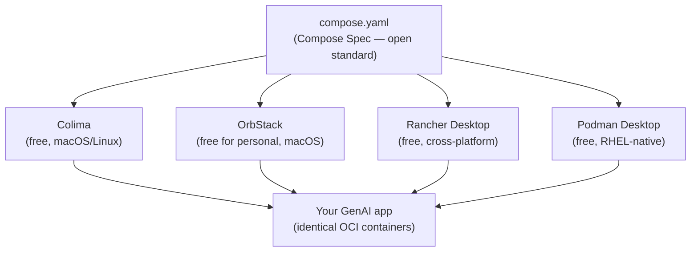
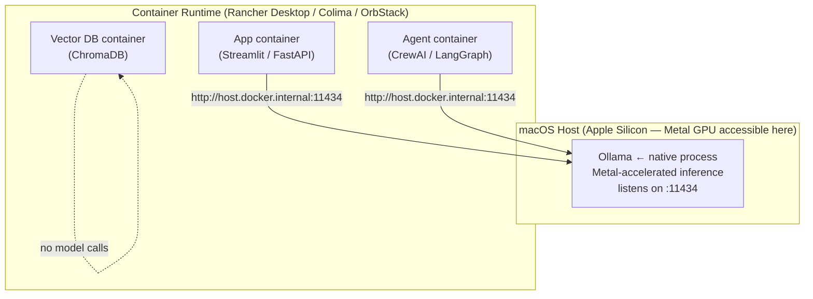

import Slides from '@site/src/components/Slides';

# Lesson: Container-Native GenAI

> **Module goal:** Here is what this module is about: why the container-native pattern exists, what it actually gives your AI stack, and how to connect a natively-served model to containerized apps on Apple Silicon. By the end of the lab, you will have proved this wiring with your own hands.

---

## Module slides

Walk through this short whiteboard deck first. It gives you the big picture before you get into the hands-on lab, and you can also open it fullscreen.

<Slides src="decks/01-container-native.html" title="Module 1 — Container-Native GenAI" />

## 1. Container-Native, Not Docker-Native

**Analogy:** Imagine an OCI image as a shipping container. The same steel box loads onto any truck, any ship, any crane, and the shipper doesn't care which carrier shows up. Your application code is the cargo. The container spec is the box. Docker, Colima, OrbStack, and Rancher Desktop are just different carriers moving that same box.

Docker Desktop is now **paid for organizations with more than 250 employees or $10 million in revenue**. That one pricing change broke an assumption a lot of teams had been making without even noticing it: that "container" simply meant "Docker Desktop." But the *standard* underneath Docker, the **OCI image format plus the Compose Spec**, is fully open, and every serious runtime implements it. Colima, OrbStack, Rancher Desktop, and Podman all run the same `compose.yaml` file without any changes.

This course is built on the open standard, not on any one vendor. You learn **container-native**, and which carrier you pick after that is entirely your call.



*One `compose.yaml`, four runtimes, the same result.* We use Rancher Desktop to validate every lab in this course, but every command works without any changes on the other three.

---

## 2. What Containers Buy an AI Stack

Think of a container as a **tightly sealed shipping crate**. The model server, the embedding pipeline, the vector database, and the agent all travel in their own sealed crate, and each one can be opened on *any* machine.

In practice, containers give an AI system four things:

| Role | What it means in practice |
|------|--------------------------|
| **Package** | Lock your Python version, CUDA driver, and library versions so "works on my machine" becomes "works on every machine" |
| **Serve** | Run the embedding service, vector DB, and API gateway behind predictable ports, without cluttering up the host machine |
| **Isolate** | Two different LLM frameworks with conflicting dependencies? Each one lives in its own container, so you never have to juggle virtualenvs |
| **Ship** | Push to any OCI registry (GHCR, Docker Hub, Quay), then pull and run it on any machine or cloud VM |

Every module in this course adds one more service to a growing `compose.yaml`. By the Capstone, you will have written the entire AI stack line by line, and you will understand every single block because you wrote it.

---

## 3. The Apple Silicon GPU Reality

> This is the most important practical lesson in the course. Get it wrong, and every lab runs three to six times slower than it should.

**Analogy:** Imagine an office building where the guest rooms have no power outlets at all. The building's electrical system (Apple Silicon's unified memory plus the Metal GPU) is right there in the walls, but the hypervisor (think of it as the building manager) never wires the guest rooms into it. So the guests, that is your containers, fall back to battery power, that is the CPU.

Here is the technical reality:

- **Hypervisor.framework (Apple's macOS virtualization layer) exposes no virtual GPU.** A container on Mac runs inside a Linux VM, and that VM has no access to the Metal GPU or the Apple Neural Engine.
- **So a model running *inside* a container on Mac falls back to CPU.** Inference would run three to six times slower than it would natively.
- **The pattern that works everywhere on Mac:** run the model server **natively** (Ollama uses Metal and unified memory directly), containerize *everything else*, and connect the two through `http://host.docker.internal:11434`.
- **On Windows with WSL2 and an NVIDIA GPU**, the NVIDIA Container Toolkit *does* pass the GPU into containers, so the model server *can* run inside a container there.



`host.docker.internal` is a special hostname. Every major container runtime resolves it to the host machine's IP address, and that is the bridge between the containerized world and your native model server.

:::tip[Why not just put Ollama in a container anyway?]

You can, and it will just run on CPU. For development with a 2B model, that slowdown is something you can live with. For anything larger, or for production throughput, running natively is the only right answer on Mac.
:::

---

## 4. The 2026 Map: Declarative Agents vs Orchestration Frameworks

A quick heads-up on what you will build in Modules 5 to 7:

**Declarative agents** (M6) define *who* the agent is and *what tools it has* in plain files: `AGENTS.md` or `SOUL.md`, plus `SKILL.md`, plus MCP tool connections. The runtime just executes them. This is the lightest approach, and the easiest to maintain: change a markdown file, and you change how the agent behaves.

**Orchestration frameworks** (M7), with LangGraph as the current standard, add *deterministic control flow*, that is, explicit state machines, branching, retries, and human-in-the-loop checkpoints. Reach for these when a task needs a guaranteed order of steps that a declarative agent cannot reliably work out on its own.

So here is the rule to remember: **start declarative, and add orchestration only when the task has hard sequencing requirements you cannot express in tool descriptions alone.** M6 and M7 build both, so you can feel this trade-off yourself instead of just reading about it.

---

## 5. The Acme Use Case + The Build Ladder

Across this course, you build one real system for a fictional company called **Acme Engineering**. Their team has runbooks, post-mortems, and architecture docs piling up in a shared drive, and nobody reads any of it. You will build two connected AI tools to fix that:

- **Use Case A: the Docs Assistant** (Day 1). This is retrieval-augmented question answering over Acme's runbooks, that is, a pipeline where a question goes in, the relevant docs get retrieved, and an answer comes out.
- **Use Case B: the Support Agent, which grows into the Incident Crew** (Day 2). This is an agentic system that *uses* the Docs Assistant as one of its tools, growing from a single agent into a full multi-agent incident-response crew.

Every module adds exactly one step to this system:

| Step | Module | What you build | Pattern |
|------|--------|---------------|---------|
| 0 | **M1** | Runtime + model responding to a call | Container-native serving |
| 1 | M2 | OpenAI-compatible model endpoint | Model serving, engine swap |
| 2 | M3 | Endpoint scaled for throughput | vLLM, batching, quantization |
| 3 | M4 | Model versioned as an OCI artifact | Model packaging (KitOps/ModelKit) |
| 4 | M5 | Docs Assistant — Naive RAG | Ingest → embed → retrieve → generate |
| 5 | M6 | Support Agent — Agentic RAG | AGENTS.md + Skills + MCP tools |
| 6 | M7 | Incident Crew — multi-agent | Declarative profiles + LangGraph |
| 7 | M8 | Platform hardened | Guardrails, SBOM, scan, sign, eval |
| 8 | Capstone | Platform shipped | End-to-end CI + portability |

You hand-author the `compose.yaml` one service block at a time, module by module. By the Capstone, it is the full production stack, and you wrote every single line of it.

---

## 6. The OpenAI-Compatible Endpoint: the Universal Contract

**Analogy:** Think of the OpenAI API as a wall socket. Different countries wire their power plants very differently behind the wall, but if the socket shape is standard, your appliance works everywhere you plug it in. Ollama, vLLM, LocalAI, and llama.cpp all expose that same standard socket, the `/v1/chat/completions` interface. Your application code never has to change when you swap out the engine behind it.

```json
POST /v1/chat/completions
{
  "model": "qwen3.5:2b",
  "messages": [{"role": "user", "content": "Summarise this runbook."}]
}
```

This call works identically against:

- `http://localhost:11434` (Ollama, dev laptop)
- `http://vllm-service:8000` (vLLM, production GPU VM)
- `https://api.openai.com` (OpenAI, if you ever need it)

This shared contract is what lets you swap from a 2B dev model to a production-grade engine without touching a single line of application code. Every lab in this course speaks this same language, the same request format, all the way from M1 to the Capstone.

---

## Summary

| Concept | The short version |
|---------|-----------------|
| Container-native | OCI + Compose Spec work on any runtime; Docker Desktop is optional |
| Containers for AI | Package, serve, isolate, and ship every component except the model server on Mac |
| Apple Silicon reality | Model server is native (Ollama + Metal); everything else is containerised; bridge = `host.docker.internal:11434` |
| Declarative vs orchestration | Start with AGENTS.md + MCP; add LangGraph only for hard sequencing |
| Build ladder | One service per module, one growing `compose.yaml` |
| OpenAI-compatible endpoint | A shared contract: swap engines without touching your app code |

---

In the lab, you will prove this container-to-native-model wiring yourself. You will spin up a throwaway container, have it call the natively-served Ollama, and get a real response back.
