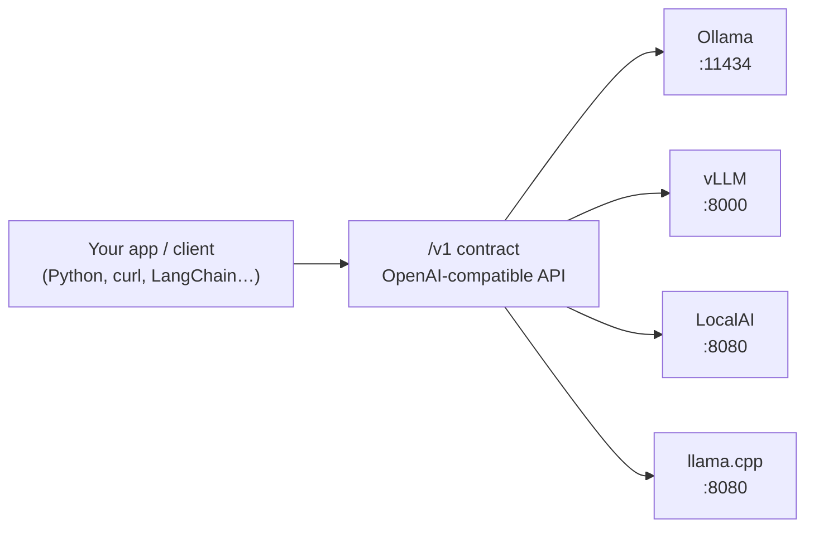
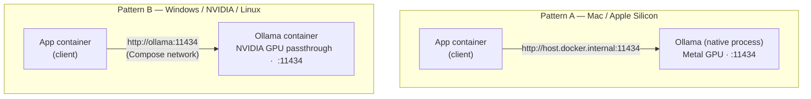

import Slides from '@site/src/components/Slides';

# Lesson: Serving Local Models

> **Module goal:** By the end of this module, you will know the main open model-serving engines out there, the OpenAI-compatible API contract that ties them all together, and the two wiring patterns that connect your containerized app to a local model. It doesn't matter if the model runs natively on the host or inside a container, both patterns work the same way.

---

## Module slides

Walk through this short whiteboard deck to get the big picture before the hands-on lab. Or open it fullscreen if that works better for you.

<Slides src="decks/02-serving.html" title="Module 2 — Serving Local Models" />

## 1. Demo First: Docker Model Runner

Docker 4.40+ ships a built-in model runner. One command and you have a served model:

```bash
docker model run ai/gpt-oss
```

Docker downloads the quantized weights, serves them, and exposes the standard `/v1` API. You don't need Ollama, you don't need a separate process, and there is nothing extra to install on the host. It's fully open source and comes free with Docker CE. For a quick demo, or for a team that already lives inside Docker's toolchain, this is the easiest way in. (`ai/gpt-oss` is a 20B model, so run it only on a machine with plenty of RAM. On our 16 GB reference laptop, stick with the smaller models from Section 4.)

This course takes a different path. We focus on *runtime-agnostic* open engines, that is, engines that don't care which container tool you use. Docker Model Runner is good to know, but the patterns ahead work the same way on Docker, Rancher Desktop, Podman, bare Linux, and Windows with WSL2. You don't need any Docker-specific tooling for them. The same principles apply to Docker Model Runner too. The engines below are the ones you'll actually wire up in the labs.

---

## 2. The Open Engines: Ollama, llama.cpp, LocalAI

**Analogy:** Imagine these engines as different brands of espresso machine: La Marzocco, Breville, DeLonghi. Each one is built differently on the inside, one uses a thermoblock, another a boiler, and each has its own pressure profile and control system. But they all pour into the *same standard cup*. That cup is the OpenAI API. You can swap the machine under the counter, and no barista needs to be retrained.

The three engines you'll encounter in this course:

| Engine | Best for | Container-ready? | Notes |
|--------|----------|-----------------|-------|
| **Ollama** | Local dev, one-command setup | Yes (with caveats on Mac) | The de-facto dev standard; Metal-accelerated natively on Apple Silicon |
| **llama.cpp** | Minimal footprint, CPU or Metal | Yes | The inference core inside Ollama; use directly for maximum control |
| **LocalAI** | Multi-backend OpenAI hub | Yes | One container routing to multiple backends: llama.cpp, Whisper, Stable Diffusion |

**Ollama** is the engine you already have running from M1. It's serving `qwen3.5:2b` on Metal at `:11434`. The lab builds a containerized client that calls it.

**llama.cpp** is the inference engine *inside* Ollama. It handles GGUF-format models, quantization, and hardware acceleration. You can run llama.cpp in its own container when you need something lighter than the full Ollama stack.

**LocalAI** is the right choice when you need *one* container that looks like OpenAI to every caller, and routes to whatever backend or hardware is available underneath. It's popular on Linux servers that run mixed hardware.

M3 adds a fourth engine, **vLLM**, for high-throughput batched inference on a GPU VM. That's coming up later. For now, for development, Ollama is the standard.

---

## 3. The OpenAI-Compatible Endpoint: The Universal Contract

**Extending the wall-socket analogy from M1:** Different countries wire their power plants differently, but a standard wall socket always delivers power the same way. You saw in M1 that Ollama exposes `/v1/chat/completions`. Here's what makes this useful: *every engine in the table above* exposes that exact same interface.

Two endpoints. That's the entire contract:

| Endpoint | What it does |
|----------|-------------|
| `POST /v1/chat/completions` | Generate a response from a list of messages |
| `GET /v1/models` | List available models |

Your application code calls one URL. That URL is an environment variable. Swap the engine, change the variable:

```bash
# Dev — Ollama, native Mac, reached from inside a container:
OPENAI_BASE_URL=http://host.docker.internal:11434/v1

# Staging — LocalAI, Compose service:
OPENAI_BASE_URL=http://localai:8080/v1

# Production — vLLM, GPU VM:
OPENAI_BASE_URL=http://vllm-service:8000/v1
```

No code change. One variable.



*The app talks to the contract. Which engine sits behind it is a deployment decision, not a code decision.*

This is the one idea that makes the rest of the course click. The Acme Docs Assistant (M5), the Support Agent (M6), and the Incident Crew (M7) all speak this same contract. So when the team decides to move from a 2B dev model to a 13B production model, the application code does not change at all.

---

## 4. GGUF and Model Selection for Laptops

**Analogy:** Quantization is like compressing a photo. A camera RAW file is huge, and mathematically it's perfect. A JPEG at 80% quality is a fraction of the size. You can barely tell the difference for most purposes, and it loads instantly. GGUF is the JPEG for LLM weights: a compact, quantized format that llama.cpp (and therefore Ollama) loads and runs well on CPU and Metal, without needing CUDA.

When you run `ollama pull qwen3.5:2b`, Ollama fetches a GGUF file at roughly `Q4_K_M` quantization, not the original float16 weights. The `2b` part is the parameter count. The quantization level is the compression setting.

**Practical sizing rule:** parameter count into 0.6 gives you roughly the RAM usage at Q4 quantization. A 7B model costs roughly 4 GB. On 16 GB unified memory, with 8 GB reserved for the OS and app containers, you have about 4 to 5 GB for the model.

**Model options at that budget:**

| Model | Approx size (Q4) | Strength | Course use |
|-------|-----------------|----------|-----------|
| `qwen3.5:2b` | ~3.1 GB | Fast iteration | Labs (already pulled) |
| `qwen3:4b` | ~2.5 GB | Better reasoning, still fast | Optional upgrade |
| **Qwen3** 4B-8B | 2-5 GB | Latest reasoning series, strong tool use | Recommended beyond labs |
| **Llama 3.2** 3B | ~2 GB | Meta's compact instruction model | Good general tasks |
| **Mistral 7B** | ~4 GB | Strong instruction following | Popular production baseline |
| **gpt-oss** 20B | too big for 16 GB | OpenAI's open-weight release; great via Docker Model Runner on bigger machines | Demo only (Section 1) |

Stay with `qwen3.5:2b` for all the labs in this course. It keeps iteration fast and the machine responsive. The model-selection decision gets more interesting in M3, when you learn to serve a model with vLLM and need to think about the trade-off between throughput and model size.

---

## 5. Two Wiring Patterns, One App

From M1 you already know the Apple Silicon constraint: the hypervisor exposes no virtual GPU, so a container on Mac falls back to CPU. The model server must run natively to get Metal acceleration. That is why Pattern A is what you use on Mac. Pattern B is what the same `compose.yaml` looks like on Windows with WSL2 and NVIDIA, or on a Linux GPU VM.



The app code in both patterns is **identical**. A single environment variable, `OPENAI_BASE_URL`, switches the target:

- **Pattern A (Mac):** `OPENAI_BASE_URL=http://host.docker.internal:11434/v1`
- **Pattern B (GPU host):** `OPENAI_BASE_URL=http://ollama:11434/v1`

The `compose.yaml` handles the difference through an env file or a Compose override. Your Python client never sees it. You build once on your laptop, and the same image drops onto a Linux GPU VM with one config change.

This portability is the real payoff of that universal contract. The app treats the engine as an addressable service, that is, something it reaches by URL and nothing more. Whether that service runs as a native process, a container on the same host, or a remote VM, the application does not need to know or care.

---

## Summary

| Concept | The short version |
|---------|-----------------|
| Docker Model Runner | Docker-native OSS option (`docker model run`); same `/v1` API underneath |
| Open engines | Ollama (dev standard), llama.cpp (core, minimal), LocalAI (multi-backend hub) |
| The `/v1` contract | Two endpoints, one URL, swap engines by changing an env var, never code |
| GGUF + quantization | Compressed weights that fit laptop RAM; Q4 ≈ 0.6 × parameter count in GB |
| Model selection | `qwen3.5:2b` for labs; Qwen3, Llama 3.x, Mistral 7B for heavier tasks |
| Two wiring patterns | Mac → native model via `host.docker.internal`; Windows/Linux → model container via Compose hostname |

---

In the lab you'll containerize a client that speaks this contract.
