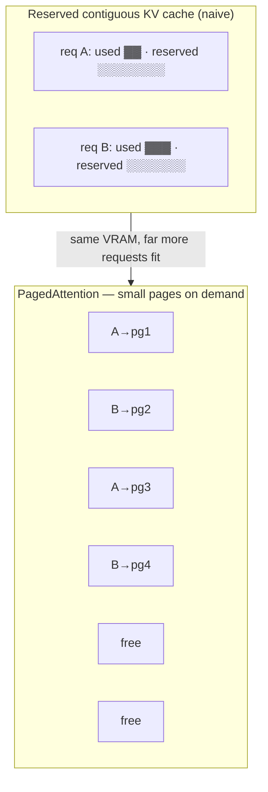
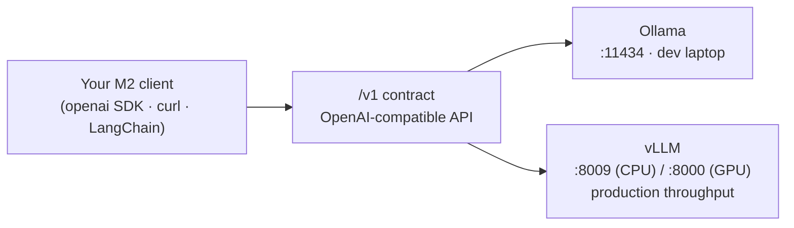

import Slides from '@site/src/components/Slides';

# Lesson: Production Serving with vLLM

> **Module goal:** In this module you'll understand why vLLM is the production workhorse for serving models, and how PagedAttention and continuous batching together win roughly three times the throughput. You'll also see how vLLM sits behind the exact same OpenAI-compatible `/v1` contract you met in M2, so your client never even notices the engine swap underneath it. You'll cover the CPU track, which is what you actually run in this module, the GPU track, which stays documented only, and where quantization fits into all of this.

---

## Module slides

Walk through this short whiteboard deck to get the big picture before you start the hands-on lab. Or open it fullscreen if you'd rather.

<Slides src="decks/03-vllm.html" title="Module 3 — Production Serving with vLLM" />

## 1. Why vLLM: from one cup at a time to a busy café

**Analogy:** Think of Ollama, the tool from M1 and M2, as a **home espresso machine**. It pulls one excellent shot at a time. Ask for a second shot while the first one is still brewing, and you wait your turn. That's fine for a developer working alone at a laptop: one request, one answer.

vLLM is the **big commercial machine behind the counter at a busy café**. It has a queue system and several group heads, and here's the important part: it never lets a group head sit idle. The moment one shot finishes, the next order slides in, *without waiting for the whole batch to finish first*. During a rush, this café serves far more coffees per hour than a row of home machines, even though each single shot takes the same time. That "never idle, always keep the heads full" trick is called **continuous batching**, and it's the single biggest reason vLLM beats simpler engines when the load is high.

Two ideas together give vLLM roughly **three times the throughput** of a simple server running on the same GPU:

- **Continuous batching**: Older servers batch requests together, run the whole batch to completion, then start the next batch. The slowest request in that batch holds up everyone else, and any slot that finishes early just sits idle. vLLM instead schedules work at the *token* level. The moment one sequence sends its last token and leaves, a waiting request takes its place right away, mid-flight. So there are no idle slots, and nobody waits around for the slow one.
- **PagedAttention**: the memory trick that makes this possible. More on this next.

### PagedAttention = virtual memory for the KV cache

**Analogy:** PagedAttention is **virtual memory paging, applied to the KV cache.** Think about how your operating system handles memory. It doesn't demand one giant, unbroken block of RAM for every program. Instead it hands out small, fixed-size *pages* and maps them wherever there's room, so memory never breaks up into unusable gaps. PagedAttention does exactly this trick for the model's **KV cache**, which is the per-token attention memory that keeps growing as a response gets longer.

Older servers would reserve one big, unbroken slab of GPU memory for every request, sized for the *maximum possible* length. So a 20-token answer sitting in a 2048-token reservation wastes 99 percent of that slab. Now multiply that across many users at once, and most of your VRAM sits reserved but empty. That means you can't fit more requests in, and throughput stalls. PagedAttention instead allocates the KV cache in small pages, on demand, and maps them with a lookup table. Memory waste drops from roughly 60 to 80 percent down to under 4 percent, so far more sequences fit in at once. And that's exactly what feeds continuous batching enough concurrent work to stay busy.



*Naive serving reserves for the worst case and wastes most of it. PagedAttention pages the KV cache the same way an OS pages RAM: almost no waste, and many more sequences running at once.*

---

## 2. Same contract, bigger engine

Here's the payoff of M2's shared-contract idea: **vLLM exposes the exact same OpenAI-compatible `/v1` API as Ollama.** Same `GET /v1/models`, same `POST /v1/chat/completions`, same response shape (`choices[0].message.content`). So swapping Ollama for vLLM is a **one-line change**: you just point `OPENAI_BASE_URL` at the new address. No code changes, no SDK changes, no image changes.



*This is the wall socket idea from M2, again: the client speaks to the contract. Which engine sits behind it, dev Ollama or production vLLM, is a deployment decision, not a code decision.*

This is exactly why the course can teach you one client and reuse it everywhere. Your M2 client, completely unchanged, will talk directly to the vLLM server you build in this lab.

---

## 3. The CPU track (what you'll run)

Apple Silicon exposes no virtual GPU to containers. That's the defining constraint you already saw back in Setup and M1. So a containerized vLLM on this Mac runs on **CPU**. And that's fine: a CPU image exists exactly so you can learn the OpenAI server, the batcher, and the quantization mechanics on *any* laptop. **It's slow on purpose. Throughput isn't the lesson here. Understanding the machinery is.** The three-times throughput story is real, but it only shows up on a GPU. On CPU, you're studying the exact same engine, just at a walking pace.

The image is `openeuler/vllm-cpu:0.9.1-oe2403lts`, a prebuilt CPU version of vLLM. It's multi-arch, which includes arm64, so it runs natively on this Mac. But it needs one patch to survive inside a container.

### Why containers report 0 NUMA nodes — and why that crashes vLLM

**Analogy:** NUMA, which stands for Non-Uniform Memory Access, is the floor plan of a physical server. It tells you which bank of RAM sits closest to which cluster of CPU cores, so software can keep data near the core that's actually using it. A **container is like a furnished apartment inside that building**: it can see its own rooms, but the building's overall floor plan is hidden from it. So from inside a container, the kernel typically reports **0 NUMA nodes**.

vLLM's CPU worker computes `cpu_count_per_numa = cpu_count // numa_size` to spread its threads across NUMA nodes. When `numa_size` is `0`, that's a **division by zero**, and the worker crashes on startup before it serves a single token. The fix is just one line, and it's the signature teaching point of this module:

```dockerfile
RUN sed -i 's/cpu_count_per_numa = cpu_count \/\/ numa_size/cpu_count_per_numa = cpu_count \/\/ numa_size if numa_size > 0 else cpu_count/g' \
    /workspace/vllm/vllm/worker/cpu_worker.py
```

It guards the division. If there are no NUMA nodes, it just uses the full CPU count instead. This is a perfect example of *why we build a small custom image* rather than run a base image as-is: one small, precise patch is enough to make an upstream image behave well inside a container.

### CPU tuning knobs that keep the laptop usable

Two environment settings do most of the work:

- **`OMP_NUM_THREADS`**: this is the main dial. It caps how many OpenMP threads vLLM uses for compute. Set it to *part* of your cores, say two to four, not all of them, so the OS and your other apps stay responsive and the machine doesn't overheat and throttle itself. On Apple Silicon, keeping it around 50 to 75 percent of the performance cores stops the slow efficiency cores from stealing the work.
- **`VLLM_CPU_KVCACHE_SPACE`**: this sets how many GB to reserve for the KV cache. Keep it small, around 1 GB, to keep memory tight on a laptop. Raise it only if you actually need longer contexts or more concurrency.

Keep BLAS single-threaded (`OPENBLAS_NUM_THREADS=1`, `MKL_NUM_THREADS=1`) so those libraries don't fight the OpenMP threads for the same cores. If BLAS *and* OpenMP are both multi-threaded at once, they thrash the cache and slow everything down.

---

## 4. The GPU track (throughput — documented, not run here)

On an NVIDIA box, the story changes: vLLM's three-times throughput is the whole point there. You use the official CUDA image and pass the GPU through to the container.

| | **CPU track (this module)** | **GPU track (production)** |
|---|---|---|
| Image | `openeuler/vllm-cpu:0.9.1-oe2403lts` | `vllm/vllm-openai:latest` |
| Hardware | any laptop CPU | NVIDIA GPU |
| Enable GPU | n/a | NVIDIA Container Toolkit + `--gpus all` |
| Shared memory | default | `--ipc=host` (multi-process attention needs it) |
| Goal | learn the engine | serve at scale (roughly three times the throughput) |

A representative GPU launch (covered read-only in the lab):

```bash
docker run --gpus all --ipc=host -p 8000:8000 \
  vllm/vllm-openai:latest --model mistralai/Mistral-7B-Instruct-v0.3
```

- **NVIDIA Container Toolkit** is what makes `--gpus all` work: it exposes the host's GPU and drivers to the container. Without it, the container just falls back to CPU.
- **`--ipc=host`** shares the host's `/dev/shm`. vLLM uses shared memory for multi-process attention, and the tiny default shm size would otherwise cause confusing crashes under load.
- **VRAM sizing:** at 16-bit precision, a 7B model needs roughly 14 GB of weights plus headroom for the KV cache. So plan for a 24 GB card, or **quantize** it (next section) to fit a smaller GPU. TGI, short for Text Generation Inference, is a reasonable alternative engine that also speaks the `/v1` contract.

This Apple GPU reality, from Setup, is why we don't run this track here. But the commands above are exactly what you would run on a Linux GPU VM, and your M2 client wouldn't change at all.

---

## 5. Quantization in practice

**Analogy:** this is the same idea as JPEG compression from M2. Quantization compresses model weights from 16-bit floats down to 4-bit or 8-bit integers. You lose a little precision, but the file shrinks a lot and loads and runs faster. On a GPU, this is often the difference between the model fitting on the card, or not.

| Format | Bits | Best for | Trade-off |
|--------|------|----------|-----------|
| **AWQ** | 4-bit | GPU inference, best accuracy at 4-bit | Activation-aware; strong quality retention, widely supported in vLLM |
| **GPTQ** | 4-bit (3/8 too) | Mature, lots of pre-quantized checkpoints on the Hub | Slightly more accuracy loss than AWQ on some models |
| **FP8** | 8-bit float | Newer GPUs (Hopper/Ada) | Near-lossless, needs hardware FP8 support |

Rule of thumb: **4-bit AWQ** roughly cuts VRAM to a quarter of FP16, for a small accuracy cost. That's often how a 7B model fits on a consumer 8 GB card. Pass in a pre-quantized checkpoint and vLLM detects the method on its own. Larger deployments would choose FP8 on capable hardware instead, for near-lossless speed.

---

## 6. Operational gotchas

- **`--ipc=host` / shared memory (GPU):** vLLM's multi-process attention needs a large `/dev/shm`. Leave out `--ipc=host` and you will hit confusing crashes under concurrency.
- **`--max-model-len`:** caps the context window, and therefore the per-request KV-cache size too. Lower it to fit your memory. Raise it only when you genuinely need a long context.
- **`--max-num-seqs`:** how many sequences the batcher packs in at once. Set it higher and you get more throughput, but you also use more memory. The sweet spot depends on your VRAM or RAM.
- **VRAM/RAM sizing:** think weights, plus KV cache, plus working memory. On CPU, an over-large `--max-model-len` into `--max-num-seqs` is the usual cause of an out-of-memory kill. Just drop one of the two.
- **The NUMA patch (CPU):** without it, the worker dies with a division-by-zero error on startup, in any container. This patch is not optional on containerized CPU hosts.
- **First run is slow:** the image itself is several GB, and the model downloads on first launch too (both get cached after that), and CPU inference is just slow by nature. So expect a wait. That's the machine working, not a hang.

---

## Summary

| Concept | The short version |
|---------|-----------------|
| Why vLLM | Continuous batching and PagedAttention together give roughly three times the throughput, under load |
| PagedAttention | Virtual-memory paging, applied to the KV cache: almost no waste, many more sequences running at once |
| Continuous batching | Token-level scheduling: a finished slot gets refilled mid-flight, so no head sits idle |
| Same `/v1` contract | Sits behind M2's OpenAI API. Swap the engine with one environment variable, never with code |
| CPU track | `openeuler/vllm-cpu` plus the NUMA patch. Slow on purpose, so you can learn the machinery |
| The NUMA patch | Containers report 0 NUMA nodes, so you guard the `// numa_size` division-by-zero |
| GPU track | `vllm/vllm-openai` plus the NVIDIA toolkit plus `--gpus all --ipc=host`. This is where the throughput payoff shows up |
| Quantization | AWQ, GPTQ (4-bit), or FP8 (8-bit): shrink VRAM for a small accuracy cost |

---

In the lab, you will serve SmolLM2 on CPU vLLM, and hit the exact same `/v1` endpoint your M2 client already speaks.
