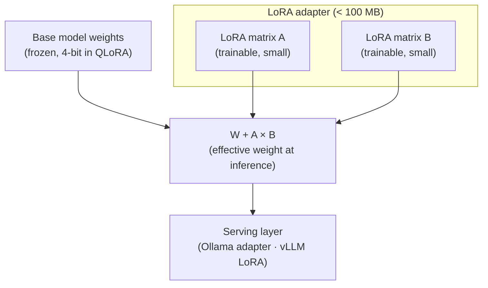
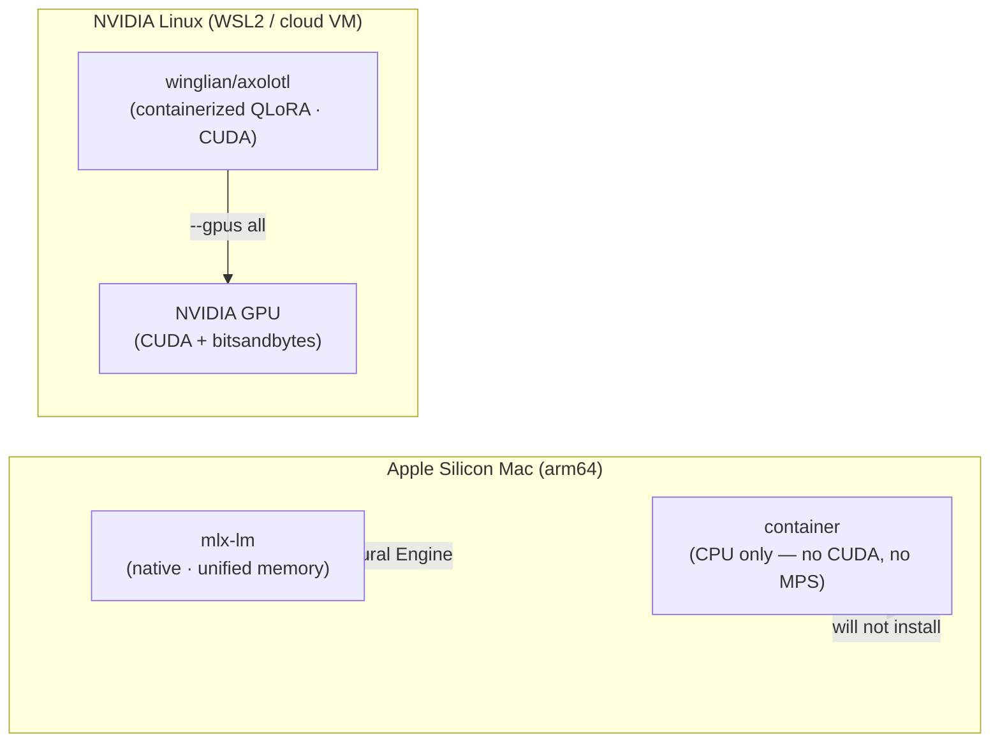

import Slides from '@site/src/components/Slides';

# Lesson: Customizing Models with LoRA/QLoRA in Containers

> **Module goal:** By the end of this lesson you will know when fine-tuning beats prompting or RAG. You will know what LoRA and QLoRA actually do to a model's weights, and which toolchain to reach for: Axolotl on NVIDIA, MLX-LM on Apple Silicon. And you will see why the container, not the script, is the thing you reproduce.

:::warning[Optional GPU-Gated Module]

This module is **optional**. It's for learners who need to produce their own custom model adapters. Track A uses Apple Silicon with native MLX-LM, and it runs on any Mac with enough unified memory. Track B uses NVIDIA QLoRA, and for that you need an NVIDIA GPU: through WSL2, a cloud VM, or a bare-metal Linux box. Neither track can use the GPU when it runs inside a container on a Mac. The training stays on the CPU.

:::

---

## Module slides

Walk through this short whiteboard deck to get the big picture before the hands-on lab. Or open it fullscreen.

<Slides src="decks/03b-finetuning.html" title="Module 3B — LoRA / QLoRA Fine-tuning" />

## 1. When to fine-tune — and when not to

Before you reach for a fine-tune, ask yourself three questions:

| Question | If yes → prefer |
|---|---|
| Can you solve it by writing a better system prompt? | **Prompting** |
| Do you need the model to reason over your private documents? | **RAG** (M5/M6) |
| Do you need the model to *behave differently* (new style, domain vocabulary, a consistent output format) in a way no prompt reliably gets you? | **Fine-tuning** |

So when does fine-tuning make sense? Here are the four cases:
- You have **50–5 000 high-quality examples** of the exact behaviour you want.
- You need **reliable output structure** (always valid JSON, always a specific schema), and few-shot prompting still breaks this once in a while.
- You're deploying to edge hardware and need a **smaller specialist model** instead of one big generalist.
- You want to teach the model a **domain dialect** (internal product names, an acronym set, a writing style) that isn't in its training data.

Fine-tuning does **not** help when your problem is really a knowledge problem. If the model doesn't know your runbooks, that's a RAG problem. And it won't help with an inference problem either, that is, when the model reasons incorrectly. For that, improve your prompt or use a smarter base model.

---

## 2. LoRA — sticky notes on a textbook

**Analogy:** Imagine you have a thick, expensive textbook. You want to annotate it for a specialist audience, medical readers, say, but you cannot rewrite the book. That would be too expensive, and you'd lose the general knowledge along with it. So instead, you stick **Post-it notes** in the margins. These are small, targeted additions that change how a reader understands a section, without touching the original printed page. When you hand the book to a general reader, you simply peel the notes off. The textbook underneath is unchanged.

**LoRA (Low-Rank Adaptation)** works exactly like that. A language model's behaviour lives inside billions of weight matrices. Full fine-tuning updates *every element* of every matrix, and that is enormously expensive in GPU memory and compute. LoRA instead freezes the original weight matrices (the textbook) and trains two small **low-rank matrices** (the sticky notes) alongside each layer. At inference time, the two small matrices get multiplied together and *added* to the frozen weights. That's a cheap operation. The trained adapter is typically **1–3% the size of the original model**, and you can hot-swap it without reloading the base weights.

**QLoRA** takes LoRA one step further. It also **quantizes the frozen base model to 4-bit** during training, which halves the GPU memory footprint again. The adapter itself stays in higher precision, so the gradient quality holds up. This is what lets you fine-tune a 7B or 13B model on a single consumer GPU.



*The base model never changes. Only the two tiny adapter matrices get trained. At serving time, the adapter is merged on the fly, or loaded hot.*

---

## 3. The toolchain

Three solid stacks cover 95% of the fine-tuning use cases you'll run into:

### Axolotl (NVIDIA, recommended for production)

Axolotl wraps Hugging Face **TRL/PEFT** behind a single YAML config file. It adds dataset pre-processing, multi-GPU support, and checkpointing on top. You describe the run in YAML, and Axolotl handles the rest.

```
axolotl.yaml → docker run winglian/axolotl → trained adapter
```

The Docker image (`winglian/axolotl`) ships with the right versions of bitsandbytes, CUDA, and PEFT pinned together. This is the real payoff for reproducibility: the image itself is the experiment record.

### Unsloth (NVIDIA, faster, memory-efficient)

Unsloth rewrites the key training kernels in Triton, and it achieves **twice the speed and 60% less VRAM** versus a standard PEFT run. It ships as a Docker image too, so it drops into the same container-based workflow as Axolotl.

### MLX-LM (Apple Silicon, native only)

Apple's **MLX** framework runs directly on the Neural Engine and GPU cores of an M-series chip, using **unified memory**. That is, the same physical RAM is shared between the CPU, GPU, and Neural Engine without copying anything back and forth. This lets you fine-tune a 3B or 7B model on a MacBook Pro with 16–32 GB of RAM.

**Key constraint:** `bitsandbytes` and CUDA don't exist on macOS. There is no Mac container that speeds up fine-tuning. MLX-LM has to run **natively** (`pip install mlx-lm`), exactly the way Ollama runs natively in M1.

---

## 4. The GPU reality



On Apple Silicon, **containerized QLoRA will not speed up your training**. Here's why:
1. `bitsandbytes` needs CUDA, and it will not install on macOS.
2. Docker containers on a Mac have no path to the Metal GPU or the Neural Engine.
3. MLX is the Apple-native alternative. It uses the same unified memory that makes Apple Silicon so good for on-device inference.

On an NVIDIA machine (WSL2, cloud VM, bare-metal Linux), the Axolotl or Unsloth containers do speed up, through `--gpus all` and the NVIDIA Container Toolkit, exactly as you saw in the M3 GPU track.

---

## 5. Reproducibility — the frozen container is the experiment

When a fine-tuning run produces a good adapter, you need to be able to reproduce it six months later. And here's the catch: scripts rot. Python versions drift, PEFT releases change their default behaviour, bitsandbytes updates alter how quantization works. An OCI image doesn't rot the same way. The `winglian/axolotl:0.9.x` image has every dependency pinned down. Tag it, push it to your registry after a successful run, and you have an immutable experiment record, that is, a record that can't quietly change under you.

```
training run → git tag + docker image tag → push to GHCR → adapter artifact
```

The YAML config goes into git. The image tag sits right alongside it. Anyone with a GPU can reproduce the run just by pulling both.

---

## 6. What you produce — and where it fits

A LoRA fine-tune gives you a **small adapter directory** (typically 50–200 MB) with two files inside: `adapter_model.safetensors` and `adapter_config.json`. From here you can:

- **Merge** it into the base model weights, which gives you one single portable file (`mlx_lm.fuse` or `peft merge`).
- **Load it hot** into Ollama (`ollama create mymodel -f Modelfile`) or vLLM (`--lora-modules`). This keeps the base model shared in memory and only swaps the adapter per request.
- **Package it** as a ModelKit artifact, with the base model reference and the adapter bundled together. That's the subject of M4, where a single `modelkit push` ships both.

This is the pipeline: fine-tune → adapter → serve (hot-swap or merge) → package → ship.

---

## Summary

| Concept | The short version |
|---|---|
| Fine-tune vs RAG | RAG = knowledge gap; fine-tune = behaviour gap |
| LoRA | Freeze the base weights; train two tiny matrices per layer; merge at inference |
| QLoRA | LoRA + 4-bit quantized base weights = fits a 7B on a consumer GPU |
| Axolotl / Unsloth | NVIDIA containers wrapping TRL/PEFT; YAML config → adapter |
| MLX-LM | Apple Silicon native only; unified memory; no CUDA required |
| The GPU reality | bitsandbytes + CUDA = Linux/NVIDIA only; Mac containers can't accelerate training |
| Reproducibility | Image tag + YAML config = immutable experiment record |
| Output | Small adapter directory; hot-loaded into Ollama or vLLM, or packaged via ModelKit |

---

In the lab, you'll run Track A (MLX-LM native fine-tune on Apple Silicon), or follow Track B (Axolotl containerized QLoRA on NVIDIA). Two different paths, same destination: a working LoRA adapter.
