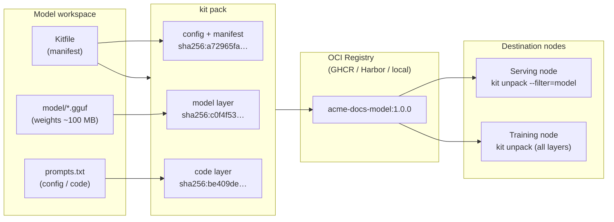

import Slides from '@site/src/components/Slides';

# Lesson: Packaging Models as OCI Artifacts

> **Module goal:** By the end of this lesson you will know why models belong in OCI registries. You will know how KitOps ModelKit bundles weights, config, and prompts into a single signed, versioned artifact. And you will know how selective pull lets a serving node grab only the layers it needs, without ever checking a multi-gigabyte GGUF file into your repo.

---

## Module slides

Walk through this short whiteboard deck to get the big picture before the hands-on lab. Or open it fullscreen.

<Slides src="decks/04-packaging.html" title="Module 4 — Packaging as OCI Artifacts" />

## 1. The problem with loose model files

You have trained (or downloaded) a model. You have a system prompt, a quantization config, maybe a dataset for fine-tuning. So how do you hand all of it to a colleague, a CI pipeline, or a Kubernetes Job running somewhere else?

The old answer is: a shared drive, a Slack message with a Hugging Face link, an `scp` to the GPU box, a README that says "remember to also grab prompts-v3-final.txt." Every receiver has to put the right combination back together by hand. Versions drift. Weights from one experiment accidentally pair with a prompt from another.

**Analogy:** Imagine you had to ship physical goods by handing people a list of warehouse addresses and saying, "go collect the parts yourself." Messy, right? Experienced logistics teams solved this problem decades ago with the shipping manifest and labelled crates. That's a single document that lists every item, signed by the sender, sealed into a labelled container that any warehouse or customs office can handle without special instructions. Open the container, and the contents are exactly what the manifest says.

A **ModelKit** is that sealed container for ML: one signed, versioned bundle of model weights, config, prompts, and optional datasets, that any OCI registry (Docker Hub, GHCR, Quay, Harbor) can store, replicate, and serve. Receivers run one command to get everything, at the exact version the sender packed.

---

## 2. What is an OCI artifact (and why models fit perfectly)

OCI (the Open Container Initiative) originally standardised container images. But the OCI image spec is really a **layered blob store with a manifest**, that is, a stack of byte blobs plus one document that lists them. A layer is any byte stream and a SHA-256 digest, which is just a fingerprint for those bytes. The manifest declares what layers exist, what type each one is, and signs the whole thing. Registries understand this natively.

A container image happens to use layers for the OS, the app, and the config. An OCI *artifact* uses that same mechanism for any content: a Helm chart, a WASM module, a software bill of materials, or a model checkpoint.

**Why models are a natural fit:**

| Container image layer | ModelKit equivalent |
|---|---|
| Base OS layer | Model weights (the heavy base) |
| App layer | Code / inference scripts |
| Config layer | Kitfile (manifest) + prompts + dataset refs |

The layer structure means registries can deduplicate across versions. If you retrain with only a new prompt config, the weights layer is already in the registry, and only the config layer gets pushed. Pull works the same way in reverse, you grab only what changed.

---

## 3. KitOps and ModelKit (CNCF + ORAS)

KitOps is the CNCF project (Cloud Native Computing Foundation, the same group that hosts Kubernetes) that defines the ModelKit format and the `kit` CLI. A ModelKit is an OCI artifact whose layers carry a type:

- **model**: the weight files (`.gguf`, `.safetensors`, and so on)
- **code**: inference scripts, prompt files, adapters
- **datasets**: training or evaluation data (optional)
- **docs**: README, cards, licences (optional)

The **Kitfile** (a YAML file, think of it as the shipping manifest) describes the package: name, version, authors, and which local files map to which layer types.

Under the hood, `kit` uses **ORAS** (OCI Registry as Storage), a CNCF library that lets any language push and pull typed OCI artifacts to any compliant registry. This is why a ModelKit works the same way on Docker Hub, GHCR, Quay, Harbor, and a bare `registry:2` container. They all speak the same OCI distribution API.

Compare this with **`docker model package`**, which also packs a GGUF file into an OCI artifact. It works on Docker Desktop and on Docker CE for Linux, and the `docker model` CLI plugin is open source. So the difference is not licence or platform. It is scope. A ModelKit carries everything around the model, while Docker's artifact is a GGUF model made for Docker Model Runner:

| | **KitOps ModelKit** | **`docker model package`** |
|---|---|---|
| Standard | OCI artifact (CNCF) | OCI artifact (Docker-specific) |
| CLI | `kit`, works anywhere | `docker model`, a plugin for Docker Desktop and Docker CE |
| Registries | Any OCI registry | Docker Hub primary |
| Layer types | model / code / datasets / docs | Single model blob |
| Selective pull | `--filter=model` / `--filter=code` | Not supported |
| CNCF ecosystem | Integrates with Flux, Harbor, Argo | No |

If you want portability across registries and runtimes, for example pulling into Kubernetes with Flux, or distributing to air-gapped Harbor deployments, the CNCF path is the one to pick.

---

## 4. The Kitfile: your shipping manifest

A Kitfile is a tiny YAML file at the root of your model workspace. Here is the one you'll write in the lab:

```yaml
manifestVersion: "1.0.0"
package: {name: acme-docs-model, version: "1.0.0", authors: ["School of DevOps & AI"]}
model: {name: SmolLM2-135M-Instruct, path: ./model/SmolLM2-135M-Instruct-Q4_K_M.gguf}
code:  [{path: ./prompts.txt, description: "System prompt / config"}]
```

Each field maps to an OCI layer:

- **`manifestVersion`**: the schema version (always `"1.0.0"` for KitOps v1)
- **`package`**: metadata that becomes the OCI manifest's annotation (this is what shows up in the registry UI)
- **`model`**: the path to the weights file. This becomes the `model` typed layer
- **`code`**: the list of source files. This becomes one or more `code` typed layers

When you run `kit pack . -t <ref>`, it reads the Kitfile, hashes each file into a layer blob, writes a manifest, and stores everything in the local kit store. This is much like Docker's local image cache.

---

## 5. The full flow: Kitfile → registry → serving node



*The Kitfile describes the workspace. `kit pack` turns it into typed OCI layers. The registry stores and replicates it. Downstream nodes pull only the layers they need.*

---

## 6. Selective pull: the KitOps payoff

The layer-typed design unlocks something plain images can't do: **selective pull**.

**Analogy:** Imagine a warehouse that stores books by chapter, not by whole volume. Say you only need chapter three. You ask for just that chapter, and you don't wait for the rest of the book to be couriered over from the shelf. The catalogue (that's the manifest) tells the warehouse exactly which box holds chapter three.

In KitOps, `--filter` does this:

```bash
# Pull only the model weights — skip code/datasets
kit unpack <ref> --filter=model -d ./weights-only

# Filter types: model, code, docs, datasets, prompts
```

Use cases:
- **Serving nodes**: pull the `model` layer only. They don't need training datasets or eval scripts.
- **Data-science notebooks**: pull the `datasets` layer only, for analysis, without downloading the weights.
- **CI pipelines**: pull only the `code` layer, to lint and test the inference scripts.

This can save gigabytes on every pull when your ModelKit includes a multi-GB model alongside separate dataset layers.

---

## 7. Multi-registry portability

Because ModelKit is a standard OCI artifact, `kit push` targets any OCI-compliant registry with the same command syntax:

| Registry | Command target |
|---|---|
| GitHub Container Registry | `ghcr.io/<org>/<repo>:<tag>` |
| Docker Hub | `docker.io/<user>/<repo>:<tag>` |
| Quay.io | `quay.io/<org>/<repo>:<tag>` |
| Harbor (private) | `harbor.example.com/<project>/<repo>:<tag>` |
| Local `registry:2` | `localhost:5001/<repo>:<tag>` + `--plain-http` |

The `--plain-http` flag is for HTTP-only registries (local dev, air-gapped). All other targets use TLS by default.

---

## 8. ModelKit vs a plain container image

A plain container image can technically hold a model file. You've probably seen teams do `COPY model.gguf /app/`. But this creates structural problems:

1. **You can't skip layers.** Docker pulls the entire image. There's no `--filter` for individual `COPY` layers.
2. **No layer types.** Registries treat every layer as plain bytes with no meaning attached. A CI tool can't ask for "just the model" without writing custom logic.
3. **Images are meant to run.** OCI images carry a container config (entrypoint, env, user, and so on). A plain image holding only a GGUF file wastes space on that metadata, and it confuses tooling that expects a runnable image.
4. **Deduplication happens by accident, not by design.** If your model GGUF sits in one layer and is shared across tags, Docker will deduplicate it. But you have to arrange your Dockerfile carefully and hope nothing else changes that layer. ModelKit makes this explicit instead of accidental.

A ModelKit uses OCI to move files around, not to run them, that is, it's a distribution mechanism, not an execution mechanism. The weights are never "run" as a container. They get unpacked to a directory, and then a runtime (`llama.cpp`, `vllm`, `ollama`, etc.) loads them. That runtime is the piece that gets containerized separately.

---

## Summary

| Concept | The short version |
|---|---|
| Why OCI for models | Signed, versioned, registry-native bundles, using the same infrastructure as container images |
| ModelKit | OCI artifact with typed layers: model / code / datasets / docs |
| Kitfile | YAML manifest (the shipping manifest); `kit pack` reads it to produce layers |
| KitOps / CNCF | `kit` CLI plus ORAS; works on any OCI registry; part of the CNCF ecosystem |
| Selective pull | `--filter=model` pulls only the weights layer, skip datasets or code |
| Multi-registry | Same `kit push`/`unpack` syntax for GHCR, Docker Hub, Quay, Harbor, local |
| vs `docker model package` | KitOps is CNCF-portable, multi-layer, and supports selective pull; Docker's packs GGUF weights for Docker Model Runner |

---

In the lab you'll pack SmolLM2-135M-Instruct (GGUF) and a prompts file into a ModelKit, push it to a registry, pull it into a clean directory to prove portability, and then selective-pull just the model layer.
