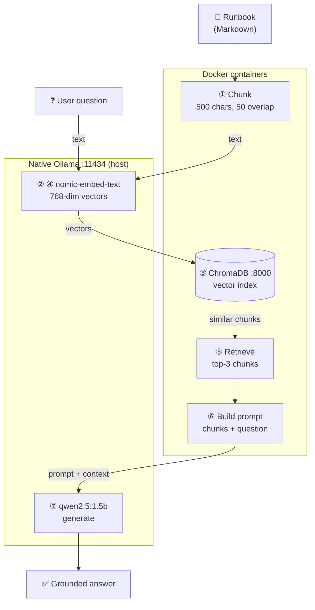

import Slides from '@site/src/components/Slides';

# Lesson: Docs Assistant — Naive RAG

> **Module goal:** In this module you will build a real GenAI application: a Docs Assistant that answers questions grounded in Acme's runbooks. You will wire together an LLM endpoint, an embedding model, a vector database, and a Streamlit UI into a naive-RAG pipeline. Once you see where naive RAG breaks, Module 6's agentic approach will make a lot more sense.

---

## Module slides

Walk through this short whiteboard deck for the big picture before you start the hands-on lab. Or open it fullscreen if you'd rather.

<Slides src="decks/05-naive-rag.html" title="Module 5 — Docs Assistant, Naive RAG" />

## 1. The problem: ungrounded answers

In Modules 2 and 3 you served a model and fired prompts at it. A raw LLM is powerful, but it is unreliable for factual questions about *your* systems. It answers confidently from its training data, and that data predates your runbooks. It knows nothing about Acme's Kubernetes namespaces. Ask it "How do I restart the payments service?" and it will hand you a command that sounds plausible, but it will not be the correct one.

**Retrieval-Augmented Generation (RAG)** solves this by giving the model a cheat sheet at query time. You pull the relevant text from your own documents and paste it into the prompt. The model generates its answer *from that context*, not from its own weights. You don't need any fine-tuning or retraining here, just wiring.

This module is the first of the **Use Case A: Docs Assistant** arc. By the end of it, you will have a containerised app that retrieves the right Acme runbook chunk and generates a grounded answer with the exact kubectl command.

---

## 2. Anatomy of a GenAI application

Every production GenAI application has four parts:

| Component | Role | M5 concrete |
|---|---|---|
| **LLM endpoint** | Text generation | `qwen2.5:1.5b` via native Ollama :11434 |
| **Embedding model** | Convert text ↔ vectors | `nomic-embed-text` (768-dim) via Ollama |
| **Vector database** | Store and search by semantic similarity | ChromaDB 0.5.20 in a container |
| **Application** | Run the pipeline, serve the UI, handle state | Streamlit app in a container |

You already built the first two in Modules 2 and 3. This module adds the vector database and the application layer, so your `compose.yaml` grows by two services.

---

## 3. The librarian analogy

Before we get into vectors, here is the main idea you need for a vector database:

**A traditional database is a filing cabinet labelled by title.** Ask for "Payments Runbook" and you get the exact file, as long as you know the exact name. Ask "what do I do if payments falls over?" and it gives you nothing back. There is no file with that name.

**A vector database is a librarian who shelves books by meaning, not by title.** She has read every document, and for each passage she works out a set of coordinates that capture its *meaning* (this is called a vector), and she files everything in that meaning-space. When you ask "How do I restart the payments service?", she turns your question into the same coordinate system and walks straight to the nearest shelf. It does not matter that the runbook never uses the word "restart," or that it sits filed under "SRE ops, payments tier, graceful bounce." Closeness in meaning beats an exact match of words.

These coordinates are called **embeddings**: dense numerical vectors, 768 numbers in `nomic-embed-text`'s case, produced by an embedding model that is trained to place similar text close together in that space. Two passages about the same topic land near each other. Passages about different things land far apart. A similarity search simply finds the nearest neighbours to your question.

---

## 4. The naive-RAG pipeline

The pipeline has two phases that share the same embedding step:

**Ingest phase** (you run this once, or any time your docs change):

1. **Load**: read the source document (Markdown, PDF, plain text)
2. **Chunk**: split it into overlapping segments (500 chars, 50-char overlap)
3. **Embed**: convert each chunk into a 768-dim vector using the embedding model
4. **Store**: write the vectors and the original text into ChromaDB

**Query phase** (runs for every user question):

5. **Embed query**: convert the question to a vector using the *same* embedding model
6. **Retrieve**: ask ChromaDB for the top-k most similar chunks (here, k = 3)
7. **Augment**: paste the retrieved chunks into the prompt as context
8. **Generate**: call the LLM with the augmented prompt, and it answers grounded in that context

Here is the full pipeline, with the container boundary marked:

*Ingest and query share the same embedding step (② / ④). The embedding model and the LLM both live in native Ollama. Only the vector store and the application UI run as Docker containers. The containers reach Ollama at `host.docker.internal:11434`.*

The Apple Silicon pattern you set up back in M2 continues here: model servers run native, so they get Metal acceleration, and everything else runs in a container and talks to the host over the Docker-managed `host.docker.internal` bridge.

---

## 5. ChromaDB: the lightest vector store

M5 uses **ChromaDB** as the vector database because it is the easiest choice to run on a laptop-sized course setup:

- **Zero-config:** one Docker service, no cluster, no configuration files
- **Python-native:** `langchain-chroma` integrates in fewer than 10 lines
- **Persistent:** a Docker volume keeps your vectors across restarts
- **Memory-efficient:** the stack runs within 2 GB total (768 MB for ChromaDB, 1 GB for the app)

ChromaDB is pinned to version `0.5.20` in the `compose.yaml`, and here is why that matters: `langchain-chroma` ships a client built for the `0.5.x` HTTP API. Run ChromaDB `0.6.x` instead, and the client's version handshake will fail. Pinning the version removes that ambiguity.

**When to scale up:**

| Scenario | Better choice |
|---|---|
| Multi-tenant, millions of vectors | **Qdrant**: purpose-built HNSW, with filtering and payload indexes |
| Already on PostgreSQL | **pgvector**: add a vector column, no new service needed |
| Managed cloud | Pinecone, Weaviate Cloud |

The API you learn here (`add_documents`, `similarity_search`) is almost the same across every alternative. Swap out the `Chroma(...)` constructor, and the rest of your LangChain code stays unchanged.

---

## 6. Learning Mode: watching the pipeline run

The Streamlit app ships with a **Learning Mode** panel, shown by default, that shows you each pipeline step in real time as you type a question:

- **Step 1 (query embedding):** confirms the question was turned into a 768-dim vector, and tells you how many milliseconds that took
- **Step 2 (similarity search):** shows how many chunks were searched, and how many came back (top-3)
- **Step 3 (retrieved context):** shows the *actual text chunks* pulled from ChromaDB, the exact runbook sentences the model is about to read
- **Step 4 (LLM generation):** shows the generation time and which model answered

This makes the invisible parts of RAG visible to you. When the grounded answer shows up, you can trace *which sentence in which document* produced it. In the lab you will watch Learning Mode show that the question "How do I restart the payments service?" retrieves the chunk containing `kubectl rollout restart deploy/payments -n prod`, and that the model's answer quotes it word for word.

In production, you would gate this view behind a developer flag. But in a course, it is the single most useful tool for building intuition about how RAG works.

---

## 7. Where naive RAG breaks

Naive RAG works well when your question closely matches the wording used in your documents. It breaks down in a few predictable ways:

| Failure mode | What happens | Example |
|---|---|---|
| **Query mismatch** | The question's embedding lands far from the answer's embedding, because the wording is different | "What happens if payments falls over?" misses the "restart" runbook |
| **Wrong chunk boundary** | The relevant sentence is split across two chunks, so neither retrieved chunk has enough context | A 500-char split cuts through a multi-step procedure |
| **Single-pass retrieval** | RAG retrieves once and hands off. If that first retrieval misses, there is no retry and no self-correction | A one-step retrieval cannot refine based on what the LLM finds ambiguous |
| **No query rewriting** | The user's natural-language question goes to the vector store exactly as typed | Jargon, typos, and abbreviations degrade similarity scores |
| **Stale index** | The vector store is not re-ingested when the runbooks change | The app answers confidently from an outdated document |

Module 6 introduces **agentic RAG**: an agent that can rewrite queries, run more than one retrieval pass, decide when the retrieved evidence is good enough, and call external tools. That covers every row in this table. And once you understand where naive RAG fails, it becomes much easier to see why the agentic approach is worth the added complexity.

---

## Summary

| Concept | The short version |
|---|---|
| Why RAG | Ground LLM answers in your own documents, not in hallucinated commands |
| 4 parts of a GenAI app | LLM endpoint + embedding model + vector DB + application |
| Vector DB analogy | A librarian who shelves by meaning, not title |
| Naive-RAG pipeline | Ingest (load → chunk → embed → store) then Query (embed → retrieve → augment → generate) |
| ChromaDB | Lightest vector store; upgrade to Qdrant or pgvector when you outgrow it |
| Container boundary | Ollama runs native (Mac/Metal); ChromaDB + app run as Docker containers, reach Ollama via `host.docker.internal` |
| Learning Mode | The app shows each pipeline step (embedding time, retrieved chunks, generation time) as it happens |
| Where naive RAG breaks | Query mismatch, wrong chunks, no follow-up, no query rewriting, stale index → M6 addresses all of these |

---

In the lab, you will hand-author the `compose.yaml` service by service, start the stack, ingest Acme's runbooks, and ask "How do I restart the payments service?" You will watch Learning Mode reveal which runbook chunk was retrieved, and see the model generate a grounded, correct answer.
