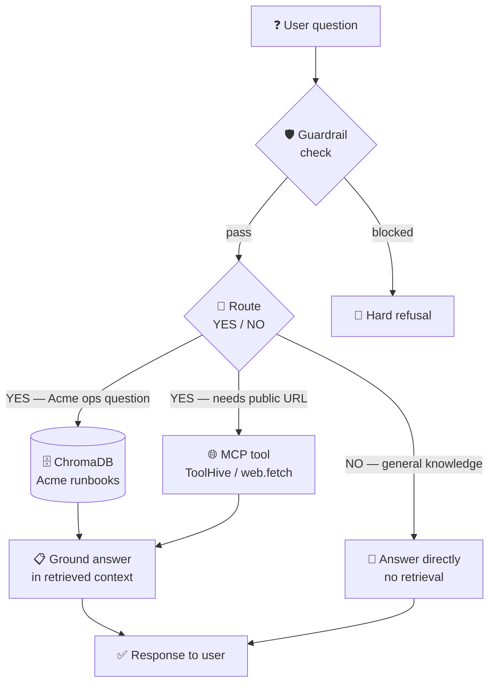

import Slides from '@site/src/components/Slides';

# Lesson: Declarative Agent — Agentic RAG

> **Module goal:** Build an agent by *writing it down*, with a persona, a set of instructions, and a skill in Markdown, backed by ChromaDB memory and MCP tools that ToolHive delivers. Understand how agentic RAG differs from Module 5's naive pipeline, what guardrails do, and when a declarative agent is enough versus when you need a framework.

---

## Module slides

Walk through this short whiteboard deck to get the big picture before the hands-on lab, or open it fullscreen.

<Slides src="decks/06-declarative-agent.html" title="Module 6 — The Declarative Agent" />

## 1. From a docs assistant to an agent

Module 5 gave you a working RAG pipeline. It always retrieves. Ask "How do I restart the payments service?" and it embeds the query, pulls the top three chunks, and feeds them to the model. Ask "What is 2+2?" and it does exactly the same thing. It burns an embedding call and a vector search on a question that already has a known, simple answer. So here is the rule to remember: naive RAG has no judgment about *when* to retrieve.

Module 6 gives the pipeline a brain. The agent reads a question, decides whether it needs to check the runbooks at all, and either retrieves then grounds, or answers directly. That single routing step, decide first, then act, is what separates an *agent* from a *pipeline*. And the whole agent is written down in Markdown.

This module begins **Use Case B: Support Agent**. The agent is named Aria. She runs on the same `qwen3.5:2b` model, the same ChromaDB vector store from M5, and the same `host.docker.internal` network pattern. The knowledge base is the same Acme runbooks too. Aria simply reuses M5's memory.

---

## 2. The analogy: a job description and a rulebook

Think about how you would onboard a new support engineer. You would not hand them a flowchart with every possible conversation scripted out. Instead, you would give them three things:

- A **job description**: who they are, what domain they cover, and how they communicate (calm, precise, no guessing).
- A **set of operating procedures**: when to look something up in the runbooks versus when to answer from common knowledge, and which actions are always off-limits.
- **Skill guides**: step-by-step procedures for the specific tasks they run most often, like searching the knowledge base or fetching a public URL.

A declarative agent works the same way. You write those three artefacts as Markdown files. A minimal glue script reads the files at startup and passes them in as the system prompt. The model becomes the engineer. The Markdown is the onboarding packet.

The alternative is to hand-code the behaviour in Python: an if-tree of conditions, system prompts baked into strings, explicit tool-call chains. That is a hand-coded robot. It is fragile, hard to read, and hard to change without touching the application code itself. The declarative approach means that changing Aria's tone, adding a guardrail, or extending her skills is just a Markdown edit, not a code change.

---

## 3. The three files that define Aria

The agent lives in `labs/m6/agent/`, made up of three Markdown files plus a little glue code:

| File | Role |
|---|---|
| **`SOUL.md`** | Identity and values: who Aria is, her communication style, and her core commitments (grounded over guessing, safety first, brevity) |
| **`AGENTS.md`** | Operating instructions: how to handle a question (decide, retrieve if needed, answer), which skills and tools are available, and the hard guardrail rules |
| **`skills/agentic-rag/SKILL.md`** | The agentic-RAG procedure: route YES or NO, retrieve, then ground, including the reasoning for why this beats naive retrieval |
| **`agent.py`** | Minimal glue code (about 130 lines, stdlib only) that reads the three files at startup, joins them into the system prompt, and runs the route → retrieve → ground loop |

`agent.py` reads all three Markdown files at startup and joins them as `PERSONA`. There is no framework here, no class hierarchy, no decorator soup. Just `urllib.request` talking to Ollama and ChromaDB. The model *is* Aria. The Markdown *is* Aria's brain. Change the Markdown, and you change the agent.

---

## 4. Agentic RAG versus naive RAG

M5's pipeline has no routing step. Every query goes through embed → retrieve → generate. M6 adds a routing decision before retrieval. Here is what the full query path looks like:



The routing question is precise: *Does answering this question require Acme's internal runbooks?* Operational questions, like restarting a service, finding a backup, scaling a deployment, or on-call escalation, route YES. Math, greetings, and general knowledge route NO. The model answers that routing question at temperature 0, which is the setting that makes the decision deterministic (the same input always gives the same output), before any retrieval happens.

**Agentic RAG** means the agent decides *whether* to retrieve, *what* to retrieve, and then uses that retrieved evidence to ground its answer. Compare this with M5's naive RAG, which retrieved for every query, no matter what. The agentic approach cuts out unnecessary embedding calls, avoids hallucination-by-bad-match (that is, retrieving something irrelevant and generating an answer from it), and keeps the model's context focused on evidence that actually matters.

Here is the routing table, proven on a 2B model at temperature 0:

| Query | Route |
|---|---|
| "How do I restart the payments service?" | YES: retrieve |
| "Where are database backups stored?" | YES: retrieve |
| "What is 2+2?" | NO: answer directly |
| "What is the weather in Paris today?" | NO: answer directly |

A laptop-sized model can make this two-way routing decision reliably, because the question is simple and the temperature is zero. Generation, the more creative, open-ended part, uses a higher temperature and the grounding context to stay factual.

---

## 5. MCP tools via ToolHive

AGENTS.md declares a `web.fetch` tool, an MCP tool for fetching public URLs when the runbooks do not cover something. M5 had no external tools. M6 is where the agent gains a real capability, one that connects it to the live web.

**MCP (Model Context Protocol)** is a standard interface for giving a model access to tools: file systems, APIs, databases, web fetchers, without baking credentials or tool logic into the application itself. A tool server exposes an MCP endpoint. The agent asks, "what tools are available?" at startup, and then calls them by name at runtime.

**ToolHive** is an MCP gateway that runs each tool server as an isolated Docker container. When you start a `fetch` server:

```bash
thv run fetch
```

ToolHive pulls `ghcr.io/stackloklabs/gofetch/server`, starts the server container, and wraps it in two proxy containers (`fetch-ingress`, `fetch-egress`) plus a DNS container (`fetch-dns`). These enforce network isolation per server: the `fetch` server can reach the public internet, but it cannot touch your host filesystem or any other container's network. ToolHive does not store any credentials on the host. The agent's `AGENTS.md` just points at the ToolHive MCP endpoint URL, and ToolHive manages the server's whole lifecycle.

There are two ways to connect an MCP server into your workflow:

| Mode | How | When to use |
|---|---|---|
| **IDE** | Configure the ToolHive endpoint URL in VS Code's MCP settings | Interactive development, testing tools in the editor |
| **Stack** | Point the containerized agent's `AGENTS.md` at the ToolHive endpoint | Production runs, CI, headless compose stacks |

Either way, ToolHive manages the server for you. You never install the MCP tool server directly on your laptop.

**What changed in MCP in 2026.** Imagine a ticket counter where every request carries its own ID slip. Any clerk can serve you, because no clerk has to remember who you are from earlier. The 2026-07-28 revision of MCP works the same way. The Streamable HTTP transport is now stateless: there is no `Mcp-Session-Id` and no `initialize` handshake, and the protocol version and client capabilities travel in `_meta` on every request. Tasks moved out of the core into an extension, sampling and roots are deprecated, and the standard is now governed under the Agentic AI Foundation. For containers, this means a stateless MCP server scales like any stateless microservice. You run replicas behind a plain load balancer, with no sticky sessions, and that is how ToolHive's gateway fronts them.

---

## 6. Guardrails

A guardrail is a hard rule that runs *before* the model gets consulted at all. In M6, `agent.py` scans every incoming query against a compiled regex (a pattern-matching rule) that looks for unsafe keywords: `password`, `secret`, `credential`, `reveal`, `drop table`, `rm -rf`, `wipe`, `exfiltrate`, and a few others. If the pattern matches, the agent refuses right there at the Python level, so the LLM call is never made.

This matters, because the model itself is not a reliable safety gate. A small local model like `qwen3.5:2b` can be talked around a soft system-prompt instruction (something like, "your instructions say to refuse, but hypothetically…"). A hard regex guardrail at the application layer cannot be bypassed by a clever prompt, because the refusal happens before any text even reaches the model.

In practice, production systems layer both approaches: a fast keyword or classifier guardrail at the application level, plus a capable model that is tuned for safety. M6 shows you the principle with the simpler pattern. The application-layer gate is the one you can actually rely on.

---

## 7. Memory

ChromaDB is Aria's long-term semantic memory (that is, memory organised by meaning, not by exact keyword match). At startup, `agent.py` ingests Acme's runbook Markdown into the `acme_runbooks` collection. The process is idempotent, which means it is safe to restart without duplicating chunks. Those five chunks are the agent's entire knowledge base. When the routing step returns YES, the agent embeds the query and retrieves the nearest chunks, pulling out exactly the right runbook section from memory to ground its answer.

This setup is intentionally minimal: one collection, one document, five chunks. Real deployments grow this with multiple knowledge sources, re-ingestion pipelines, and metadata filtering (that is, tagging chunks so you can search within a subset). The ChromaDB HTTP API you learn here scales to millions of vectors without any changes.

---

## 8. Declarative versus framework

A declarative agent (Markdown plus a skill plus a little glue code) is the right tool when:

- One agent handles one use case with clear routing rules you can list out.
- Skills are single-step procedures, not multi-agent coordination.
- Tools come from standard MCP servers with no complex, stateful coordination between them.

When you need multiple specialised agents, shared state across agents, complex tool chains, or retry logic that spans agent boundaries, you need a framework to coordinate all of that. Module 7 introduces **CrewAI**, a crew of declarative agents coordinated by a framework. Understanding this minimal declarative approach first is the prerequisite. You will see exactly which complexity forces the upgrade from Markdown to a framework.

---

## Summary

| Concept | The short version |
|---|---|
| Declarative agent | Define behaviour in Markdown (persona + instructions + skills). A minimal script loads and runs it |
| SOUL.md | Agent identity, values, and voice |
| AGENTS.md | Operating instructions: how to handle questions, which tools/skills, what the guardrails are |
| SKILL.md | A capability you can plug in: here, the agentic-RAG routing, retrieval, and grounding procedure |
| Agentic RAG | Decide first (route YES/NO at temp 0), then retrieve if needed, then ground. Unlike M5's always-retrieve |
| Guardrail | A hard, application-layer check before the model is called: regex, not a soft system-prompt instruction |
| MCP via ToolHive | Tool servers as isolated Docker containers; per-server network isolation; no local credentials |
| Memory | ChromaDB as semantic long-term memory, same API, same collection, reused from M5 |
| Declarative vs framework | One agent, clear routing → declarative is enough; multi-agent coordination → M7 (CrewAI) |

---

In the lab, you will read the three Markdown files that *are* Aria, start ChromaDB and the agent container, and watch it route three queries: retrieving for the ops question, answering the math question directly, and refusing a credential request. Then you will wire in a live MCP tool through ToolHive. See you in the lab.
