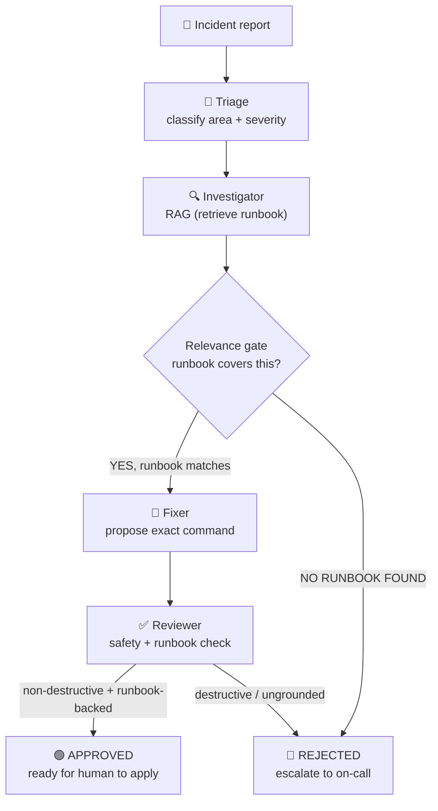

import Slides from '@site/src/components/Slides';

# Lesson: Multi-Agent Incident Crew

> **Module goal:** Grow the single declarative agent from M6 into a crew of four specialised agents: Triage, Investigator, Fixer, Reviewer, all sharing one native model endpoint. Understand *why* you would go multi-agent, *when* a single agent is enough, and the two paths to get there: declarative (what you build yourself) and framework (CrewAI / LangGraph).

---

## Module slides

Walk through this short whiteboard deck to get the big picture before the hands-on lab, or open it fullscreen.

<Slides src="decks/07-multi-agent.html" title="Module 7 — Multi-Agent Incident Crew" />

## 1. The analogy: a hospital, not a superhero

A single powerful agent sounds tempting. One prompt, one response, done. But think about what happens when you walk into a hospital with a serious complaint.

A single doctor does *not* receive you at the door, diagnose you, write the prescription, and then sign off on their own order. Instead the hospital runs you through a crew. A **triage nurse** classifies your urgency and sends you to the right department. A **diagnosing doctor** looks at your symptoms and checks the patient record. A **pharmacist** turns the diagnosis into an exact remedy. And an **attending physician** reviews the prescription before it reaches you, and refuses to sign anything that looks wrong.

Each role has exactly one job. Each one has a clear lane, a clear input, and a clear output. No single person makes every decision. So why the extra review step? Because the diagnosing doctor and the pharmacist can each make a mistake, and the attending is there to catch it.

Your incident crew works the same way. Triage classifies the incident. The Investigator looks up the runbook, which plays the role of the patient record here. The Fixer proposes the exact fix command. The Reviewer checks the proposed fix against the runbook and approves or rejects it. One shared model serves all four, just as four hospital staff share one electronic health record system.

---

## 2. Why multi-agent?

The hospital analogy shows us three things a single agent cannot give you.

**Specialisation.** A triage agent runs at temperature 0, that is, it is set to give the same, most predictable answer each time, and it outputs one line. An investigator agent queries a vector store and reports back exactly what it finds, word for word. A fixer agent proposes one exact command. A reviewer agent checks safety. Each prompt stays small, the context stays small, and a 2B laptop model can handle each task reliably. Ask one agent to do all four jobs in sequence, or worse, in a single prompt, and you overload its context, blur the roles, and make the output harder to check.

**Separation of concerns**, that is, keeping each agent's job separate from the others. Each agent sees only what it needs. The Triage agent never sees the runbook. The Fixer never checks safety. This is not just tidier design. It directly cuts down the chance of a small model hallucinating, that is, making something up with confidence, across a task boundary it was never built for.

**Review loops.** The Reviewer is the most important member of the crew. Think of it as a stand-in for the human in the loop, a role that exists only to check the Fixer's output against the runbook and refuse anything destructive or ungrounded. Without a review loop, a fix that sounds confident but is actually wrong would ship straight to production. With it, a human gets a clear APPROVED recommendation or a clear REJECTED/escalate signal, and makes the final call.

### When is a single agent enough?

Multi-agent adds real overhead. More prompts, more latency, more moving parts. Do not reach for it by default.

A single declarative agent, the M6 pattern, is the right tool when:
- One agent handles one use case end to end (question to answer, or query to retrieve to ground).
- There is no need for a separate safety review on the output.
- The task does not produce an action (a command, a deployment, an API call) that needs a second signature.

Reach for a crew when the task produces a consequential action, when reviewing that action is a job of its own, or when specialisation actually makes a small model more reliable.

---

## 3. The incident crew's pipeline

The crew runs as a pipeline, one stage after another. Every stage sees the incident. The Investigator adds the runbook passage, the Fixer works from that passage, and the Reviewer checks the proposed fix against the same passage. Triage's classification is printed for the operator, not fed forward. The pipeline stops early if no runbook is found.

The **relevance gate** between the Investigator and the Fixer is not optional. Naive vector search always returns the closest match it can find, that is the nearest neighbour, even when that neighbour has nothing to do with the incident. During validation the crew confidently proposed the *payments* runbook for a *Kafka* outage, because the Kafka query had no better match and the model never questioned the result. The gate asks the model one plain yes or no question: does this passage actually address this incident? If the answer is NO, the Fixer steps back and the Reviewer rejects. A badly wrong fix never reaches the output.

---

## 4. Two paths to multi-agent

### Declarative (the default)

In M6 you defined one agent as a Markdown profile plus a small glue script. The crew grows this same pattern: four Markdown profiles, one Python pipeline, all sharing one Ollama endpoint. No framework, no extra dependency beyond the standard library. Each agent is just a Python function that reads its own profile, calls the model once, and returns a string.

This is the right default for most crews. The flow is predictable and sequential, there is no state machine, and there is no retry logic to manage across agent boundaries. With the declarative approach, changing an agent's behaviour is a Markdown edit, not a code change. Same principle as M6, now applied to four agents working together.

### Framework: CrewAI and LangGraph

Two frameworks add structure when the declarative approach is not enough.

**CrewAI** hands out roles: agents are defined in `agents.yaml`, tasks in `tasks.yaml`, and CrewAI handles the message routing, delegation, and retry logic between them. Reach for it when your crew needs dynamic task assignment, or when agents need to work together in patterns that are not strictly sequential.

**LangGraph** draws the crew as an explicit graph, with checkpointing built in so you can save progress at each step. Every edge is a conditional branch, every node is a function. You can pause execution at any node, look at its state, and resume from there. Reach for LangGraph when you need control that is deterministic and auditable over a complex workflow, when a question like "what happened between step 3 and step 4?" needs a real, verifiable answer.

### The standards converge

Both frameworks work with the same building blocks you already know: MCP for tools, ChromaDB for memory, Ollama for the model. The orchestrator changes, the tools and the model do not. You can swap CrewAI for LangGraph, or for the declarative approach, without touching how agents call tools or how they reach the knowledge base. This is the same idea as the OpenAI-compatible endpoint from earlier modules. Build against the standard, and you can swap out the implementation underneath.

---

## 5. One model, four agents

Let's put a number on the resource budget. On a 16 GB laptop running `qwen3.5:2b`:

| Component | Resource |
|---|---|
| The model (`qwen3.5:2b`, as `ollama ps` reports it) | ~3.5 GB GPU memory |
| Embedding model (`nomic-embed-text`) | ~0.3 GB |
| ChromaDB | ~15 MB RAM |
| One crew container (4 agents) | ~15 MB RAM |
| **Total** | **~4 GB** |

Agents are cheap. A "crew" is just four Python functions with four system prompts. The model is the expensive part, and it is shared. Running four separate copies of the model, one per agent, would need four times the memory for no real gain. All four agents call the same Ollama endpoint, one after another. This is the same idea you used in M6. The model serves natively on the host, containers reach it over `host.docker.internal`, and the crew container costs almost nothing to run.

A framework crew (CrewAI) using `gemma3:4B` needs a model of about 4 GB, so roughly 4.5 GB in total. The declarative 2B crew is the laptop-friendly default. Reach for a bigger model only when the framework's more complex coordination actually demands it.

---

## 6. The Reviewer as human-in-the-loop proxy

The Reviewer's job is subtle but critical. It does not decide *whether* to fix the incident. That is the Fixer's job. It decides *whether the proposed fix is safe to show a human*.

Its rules are simple. APPROVE if the command is non-destructive and comes word for word from the runbook. REJECT if the command destroys data, touches secrets, or was never in the runbook. When in doubt, REJECT.

Think of this as a stand-in for the human review that would happen in a real incident-response workflow. The crew does not apply fixes on its own. It produces a checked recommendation and a clear outcome, APPROVED or REJECTED/escalate, that a human engineer reads and acts on. The automation earns its place by doing the triage, the retrieval, and the first safety check. The human keeps the final say.

---

## Summary

| Concept | The short version |
|---|---|
| Multi-agent crew | Multiple specialised agents in a pipeline, each with one job, sharing one model |
| Why multi-agent | Specialisation, separation of concerns, review loops, especially for consequential actions |
| When one agent is enough | One use case, no safety review needed, no consequential action |
| Declarative crew | Four Markdown profiles + one Python pipeline; change behaviour with Markdown edits |
| Framework (CrewAI) | Role-based coordination (`agents.yaml`/`tasks.yaml`); reach for it when you need dynamic delegation |
| Framework (LangGraph) | Explicit graph + checkpointing; reach for it when you need auditable, deterministic control |
| One shared model | Agents are cheap Python calls; the model is shared, no per-agent model instance |
| Relevance gate | Explicitly confirm the retrieved runbook matches the incident before the Fixer acts |
| Reviewer | Human-in-the-loop proxy: APPROVE or REJECT/escalate; humans retain final authority |
| Standards converge | MCP + ChromaDB + Ollama are the same across declarative and framework crews |

---

Now, in the lab you will read the four agent profiles, run the crew against a 503 incident (APPROVED) and a Kafka incident (REJECTED/escalate), and see what happens at the relevance gate when no runbook matches.
