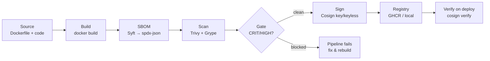

import Slides from '@site/src/components/Slides';

# Lesson: Securing & Governing AI Workloads

> **Module goal:** Harden and ship the M7 crew using open tools: a software bill of materials, vulnerability scanning, image signing, sandboxed code execution, input and output guardrails, a lightweight evaluation, and a GitHub Actions pipeline that checks security before it signs anything.

---

## Module slides

Walk through this short whiteboard deck for the big picture before you start the hands-on lab. You can also open it fullscreen.

<Slides src="decks/08-security.html" title="Module 8 — Securing & Governing AI" />

## 1. The analogy: ingredients label, health inspection, tamper seal

Imagine you are a food manufacturer shipping a new product, say a ready meal that goes out to thousands of supermarkets. Before it leaves your factory, three things happen as a matter of law and trust:

1. **An ingredients label** is printed on every pack, listing every substance inside. Consumers can check for allergens; regulators can audit for compliance.
2. **A health inspection** happens next. An independent body checks for contaminants and rejects any batch that fails the threshold.
3. **A tamper-evident seal** goes on the lid. Any retailer or consumer who receives a broken seal knows the product may have been compromised in transit.

Now think about shipping an AI workload, a container image carrying a Python agent, its dependencies, and the framework code that drives it, with none of these three checks. No one knows what packages are inside. No one has checked whether those packages carry known vulnerabilities. And no one can tell, after the image travels through a registry and lands on a production host, whether it has been swapped for something else.

That is the gap this module closes. The **SBOM** (Software Bill of Materials) is the ingredients label. The **vulnerability scan** is the health inspection. The **image signature** is the tamper-evident seal. Together they form a supply chain that makes the image trustworthy, easy to audit, and easy to verify at every hop: from your laptop, to the registry, to the production host.

---

## 2. The supply chain pipeline

Every image that carries an agent, a model, or generated code should pass through this pipeline before you deploy it.



So this is the important point: the gate is the critical piece here. A pipeline that builds, signs, and pushes without a scan gate just ships vulnerabilities with a stamp of approval stuck on them. The scan has to run before the sign, and the sign must never run if the scan fails.

---

## 3. The SBOM: ingredients label for your image

Syft (from Anchore) looks inside a container image and catalogs every package it finds: Debian debs, Python wheels, Go binaries, npm modules, all into one standard format. The most portable output is SPDX-JSON, an open standard that any security tool can read.

```bash
syft acme-support-agent:latest -o spdx-json > sbom.spdx.json
# -> 96 packages, SPDX-2.3  (Debian debs + Python + binaries)
```

The SBOM does two jobs for you. First, it feeds the vulnerability scanners. You don't strictly need this separate SBOM step, since the scanners can generate one themselves from the image, but exporting it on its own means you can store it alongside the image in the registry. Second, it is the audit artifact that answers the regulator's question: *"what exactly is in that image?"*

---

## 4. Vulnerability scanning: two scanners disagree — that is a feature

Run two scanners on the same image and you get two different sets of results. That is not because one tool failed. It is because CVE databases and matching rules differ across vendors. Trivy (from Aqua Security) and Grype (from Anchore) each keep their own advisory feeds, so the same package version might show up in one and not the other.

So here is the rule to remember from the lab evidence: run more than one scanner, and triage by whether a fix is available and how severe the finding is. A Critical finding with a fixed version already in the base image's repository, you should fix right away. A High finding with no upstream fix yet is worth logging and tracking, but it should not block a deployment forever if you already have other controls in place to reduce the risk.

The triage heuristic:
- **Critical/High with a fix available**: rebuild on the patched base, bump the package, and re-scan.
- **Critical/High with no fix**: mitigate with network policy or sandboxing, and document the accepted risk.
- **Medium and below**: log it in the SBOM, re-scan on a regular schedule, and do not block CI.

The scan gate in the GitHub Actions pipeline (`exit-code: '1'`) fails the build on any Critical or High finding. Once your base image is clean of fixable highs, the pipeline moves through without a hitch.

---

## 5. Signing: the tamper-evident seal

Cosign (from Sigstore) attaches a cryptographic signature to a container image sitting in the registry. Anyone downstream, be it a Kubernetes admission controller, a deploy script, or a human reviewer, can verify that the image they are about to run is the exact artifact that passed through the supply chain, signed by the expected key.

Two signing modes exist:

| Mode | When | How |
|---|---|---|
| **Key-based** | Local dev, air-gapped, offline lab | `cosign generate-key-pair` → `cosign sign --key cosign.key` |
| **Keyless (OIDC)** | GitHub Actions / CI with OIDC | `cosign sign --yes` (identity from the workflow's OIDC token; no private key stored in the repo) |

In CI, keyless is the right default. The workflow's GitHub Actions identity (the `id-token: write` permission) gets bound to the signature through Sigstore's Fulcio CA. You don't have to manage a key, rotate anything, or worry about a leaked private key. In the lab, though, you use key-based signing for transparency. You can see the key files and understand what is happening before the CI automation hides the mechanics from you.

Verification is the step that closes the loop:

```bash
cosign verify --key cosign.pub <registry>/acme-support-agent:1.0.0
# -> "The signatures were verified against the specified public key"
```

At deploy time, a policy engine (OPA Gatekeeper, Kyverno, or even a simple pre-deploy script) can run this same verify step and refuse to pull any image that does not carry a valid signature from the expected key.

---

## 6. Sandboxing agent, tool, and generated code

The crew's Fixer proposes commands. In an automated pipeline, the pipeline might run those commands directly. In a more agentic system, a code-generation agent might write Python to analyze logs or transform data. Neither of these should run on the host with the agent's full privileges.

The pattern here is what you can call an ephemeral, locked-down container: a throwaway environment you use once, with no network, a read-only filesystem, every Linux capability dropped, a limit on processes, and a memory cap.

```bash
docker run --rm \
  --network none \
  --read-only \
  --cap-drop ALL \
  --security-opt no-new-privileges \
  --pids-limit 64 \
  --memory 256m \
  --cpus 1 \
  python:3.12-slim python -c "print('sandboxed result:', sum(range(10)))"
# -> sandboxed result: 45
```

The isolation is real, and you can verify it yourself. A network request from inside the sandbox fails with `URLError: network unreachable`. Any attempt to escalate privileges fails silently. You throw away the container after one use, so it cannot build up state or carry a compromise forward.

For deeper isolation, two tools build on this pattern:

- **gVisor** swaps out the Linux kernel's syscall surface for a user-space layer that intercepts calls. Even if the sandboxed code finds and exploits a kernel vulnerability, it hits gVisor's interceptor first, not the host kernel.
- **ToolHive** manages MCP tool servers as isolated containers. Each tool server, be it web search, a code interpreter, or the file system, runs in its own container with its own network and filesystem policy. The agent never runs tools inside its own process. Instead, it calls ToolHive, which runs the tool in isolation and hands back the result.

---

## 7. Hardening the container image

The sandbox handles untrusted code. But the agent image itself also needs hardening, since it is the environment that *calls* the LLM, *reads* credentials, and *routes* between tools.

Here is the hardening checklist:

| Control | How |
|---|---|
| **Least privilege** | Run as a non-root user (`USER appuser`) |
| **Read-only rootfs** | `--read-only` flag or `ReadOnlyRootFilesystem: true` in the pod spec |
| **Drop capabilities** | `--cap-drop ALL`, then add back only what is strictly needed |
| **No privilege escalation** | `--security-opt no-new-privileges` |
| **Resource caps** | `--memory`, `--pids-limit`, `--cpus` |
| **Secrets** | Never in the image; mount via Docker secrets, environment variables from a secret store, or Kubernetes secrets |
| **Health checks** | `HEALTHCHECK` in the Dockerfile; liveness/readiness probes in Kubernetes |

These controls add up. A container with a read-only rootfs and no capabilities has a much smaller attack surface, even if someone exploits a vulnerability in a Python dependency.

---

## 8. Guardrails and evaluation

Security at the container and supply chain level protects the infrastructure. Guardrails protect the model boundary, that is, the inputs going in and the outputs coming out.

**Input guardrails** screen user queries for prompt injection, jailbreak attempts, and out-of-scope requests before the query ever reaches the model. The M6 guardrail pattern, a small classification call at the start of the pipeline, is the right default here. It adds one extra inference call (cheap on a small model) and stops the most common abuse attempts.

**Output guardrails** screen the model's response before it reaches the user or triggers any downstream action. For the incident crew, the Reviewer already acts as an output guardrail: it blocks destructive commands. For a customer-facing agent, an output guardrail would also check for PII leakage, hallucinated URLs, and off-brand content.

**Evaluation** is how you know the guardrails and the agent are actually working. A **lightweight eval** runs a small set of labeled test cases through the full pipeline and checks:
- Does the agent refuse prompt-injection attempts? (safety)
- Does it answer in-scope questions correctly? (quality)
- Does it decline out-of-scope questions with a graceful fallback? (scope control)

Three cases per dimension, run in CI on every push, is enough to catch regressions before they ever reach production.

---

## 9. Governance without a vendor

"Governance" sounds like a vendor product. It does not have to be. Governance for an agent workload is just the documented, enforced answer to four questions:

1. **What may the agent reach?**: Network egress rules (Kubernetes NetworkPolicy, container `--network` flags, no-network sandboxes).
2. **What credentials may it use?**: Scoped service accounts, a secrets manager, never baked into the image.
3. **Which MCP tools are enabled?**: ToolHive's per-server isolation policy, an explicit tool allowlist.
4. **Who approved this deployment?**: The signed image, the CI pipeline that ran the scan gate, the Git commit that triggered it.

Answer those four questions in a YAML policy file, enforce them with open tools such as OPA, Kyverno, or ToolHive, and you have governance. The pipeline from this module (SBOM, scan, sign) is the evidence trail that makes the fourth answer easy to audit.

---

## Summary

| Concept | The short version |
|---|---|
| SBOM (Syft) | Ingredients label: catalogs every package in the image, feeds the scanners, and works as the audit artifact |
| Vulnerability scan (Trivy + Grype) | Health inspection: two scanners catch more, triage by whether it's fixable and how severe it is |
| Image signing (Cosign) | Tamper-evident seal: key-based locally, keyless OIDC in CI |
| Scan gate | The scan runs before the sign, and the sign never runs if the scan fails |
| Sandbox | Ephemeral, locked-down container for untrusted/generated code: `--network none --read-only --cap-drop ALL` |
| gVisor / ToolHive | Deeper isolation: kernel-level (gVisor) and per-MCP-tool (ToolHive) |
| Image hardening | Non-root, read-only rootfs, drop caps, no-new-privs, resource caps, external secrets |
| Guardrails | Input and output screens at the model boundary: reuse the M6 pattern |
| Lightweight eval | 3-case CI eval catches regressions in safety, quality, and scope control |
| Governance | Four documented, enforced answers: what can the agent reach, use, call, and who approved it |

---

In the lab, you will run Syft, Trivy, Grype, and Cosign against the M6 agent image. You will prove network isolation with the sandbox, wire up a guardrail and an eval, and inspect the GitHub Actions pipeline that automates all of it.
